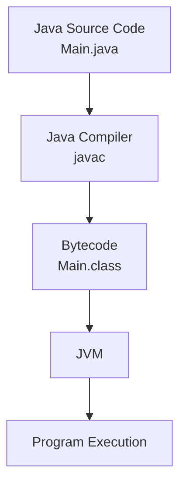
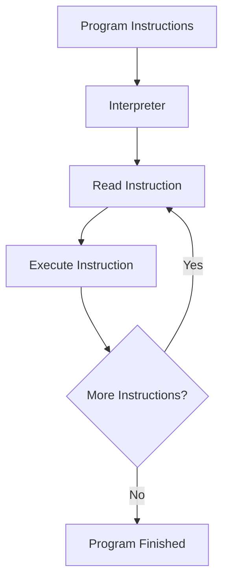
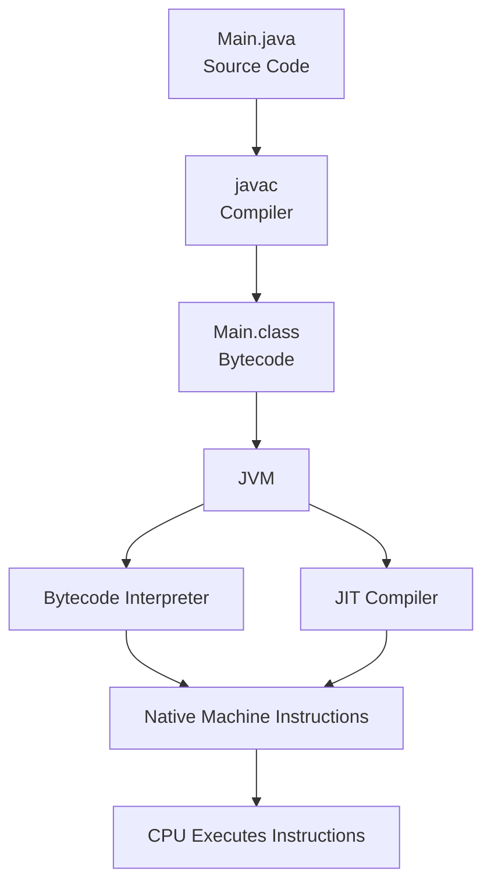
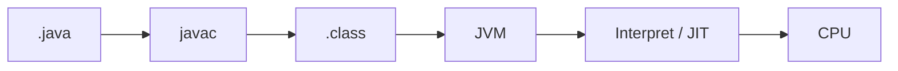
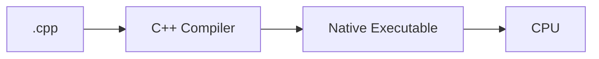
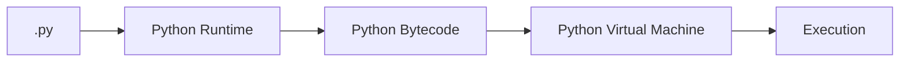

# Compiler vs Interpreter

## 1. Introduction

A computer's CPU understands machine code (binary instructions). However, developers write programs using high-level programming languages such as Java, C++, and Python.

So, how does the computer execute the code we write?

Two important concepts help us understand this:

- **Compiler:** Translates source code into another form before execution.
- **Interpreter:** Reads and executes instructions at runtime.

Java uses a combination of compilation, interpretation, and Just-In-Time (JIT) compilation.

---

## 2. What is a Compiler?

A compiler is a program that translates source code written in a programming language into another form that can be executed or processed.

For example, Java's compiler (`javac`) translates Java source code into bytecode.

### Visual representation



### Example

**Main.java**

```java
public class Main {
    public static void main(String[] args) {
        int a = 10;
        int b = 20;

        System.out.println(a + b);
    }
}
```

Compile the program:

```bash
javac Main.java
```

This generates:

```text
Main.class
```

The `.class` file contains Java bytecode, not platform-specific native machine code.

### Important points

- `javac` is the Java compiler.
- It checks source code for compilation errors.
- It translates Java source code into bytecode.
- Bytecode can be executed by a compatible JVM.

---

## 3. What is an Interpreter?

An interpreter executes program instructions at runtime.

Instead of translating the entire program into a separate native executable before execution, an interpreter reads instructions and executes them as the program runs.

### Visual representation



### Simple analogy

Imagine a person translating a book:

- A compiler is like translating the entire book before someone reads it.
- An interpreter is like translating each sentence while someone is reading it.

This analogy helps understand the general difference, although real language runtimes can be more sophisticated.

---

## 4. How Java Uses Both

Java does not rely on only a traditional compiler or only an interpreter.

It uses a combination of:

1. Compilation by `javac`.
2. Bytecode execution by the JVM.
3. Interpretation and potentially JIT compilation at runtime.

### Complete Java execution representation



The JVM may initially interpret bytecode and compile frequently executed code into native machine code using the JIT compiler.

The exact execution strategy depends on the JVM implementation and its runtime decisions.

---

## 5. Compiler vs Interpreter

| Aspect | Compiler | Interpreter |
|---|---|---|
| Main responsibility | Translates code | Executes instructions |
| Typical operation | Translation before execution | Execution at runtime |
| Output | Depends on language; may produce bytecode or machine code | May execute directly without a separate native executable |
| Error detection | Many errors are detected during compilation | Runtime errors can occur during execution |
| Example | Java `javac`, C++ compiler | Traditional interpreter implementations |

The distinction is conceptual. Modern language runtimes often combine compilation and interpretation.

---

## 6. Java vs C++ vs Python

| Language | Common execution approach |
|---|---|
| Java | Source code → bytecode → JVM interpretation/JIT |
| C++ | Source code → native machine code |
| Python (CPython) | Source code → Python bytecode → interpreter execution |

### Java



### C++



### Python (CPython)



---

## 7. Common Misconceptions

1. **Java is only interpreted.**  
   Incorrect. Java source code is compiled into bytecode, and the JVM may interpret or JIT-compile it.

2. **Java bytecode is native machine code.**  
   Incorrect. Bytecode is an intermediate instruction format understood by a JVM.

3. **C++ does not use compilation.**  
   Incorrect. C++ is commonly compiled into native machine code before execution.

4. **An interpreter never performs compilation.**  
   Incorrect. Some language runtimes compile source code into an intermediate bytecode before interpreting it.

5. **Java always compiles every method into native code.**  
   Incorrect. JIT compilation is selective and runtime-dependent.

---

## 8. Interview Questions

### Beginner

**Q1. What is a compiler?**

A compiler translates source code into another representation, such as bytecode or native machine code.

**Q2. What is an interpreter?**

An interpreter executes program instructions at runtime.

**Q3. Is Java compiled or interpreted?**

Java uses both compilation and runtime execution techniques. `javac` compiles source code into bytecode, and the JVM can interpret or JIT-compile that bytecode.

### Intermediate

**Q4. Why does Java generate bytecode instead of directly generating machine code for every operating system?**

Bytecode allows the same compiled class files to run on different platforms that provide compatible JVM implementations.

**Q5. What is the role of the JIT compiler?**

It compiles selected frequently executed bytecode into native machine code at runtime to improve performance.

---

## 9. Practice Questions

1. What happens when you run `javac Main.java`?
2. What is the difference between `.java` and `.class` files?
3. Does the JVM understand Java source code directly?
4. What is the difference between bytecode and machine code?
5. Why does Java need a JVM?
6. How does JIT compilation improve performance?

---

## 10. Quick Revision

| Term | Meaning |
|---|---|
| Compiler | Translates source code |
| Interpreter | Executes instructions at runtime |
| `javac` | Java compiler |
| Bytecode | Intermediate instructions stored in `.class` files |
| JVM | Executes Java bytecode |
| JIT | Compiles selected bytecode into native machine code |

## 11. Check Your Understanding

You should be able to explain this flow without looking at the notes:

```text
Main.java
   ↓
javac
   ↓
Main.class (Bytecode)
   ↓
JVM
   ↓
Interpreter / JIT
   ↓
Native Machine Instructions
   ↓
CPU
```

## 12. Related Topics

- [What is Java?](../01-Java-Basics/what-is-java.md)
- [Bytecode and WORA](../02-Java-Portability/bytecode-and-wora.md)
- [JVM](../03-Java-Platform/jvm.md)
- [Java Execution Flow](./java-execution-flow.md)
- [JIT Compiler](./jit-compiler.md)

