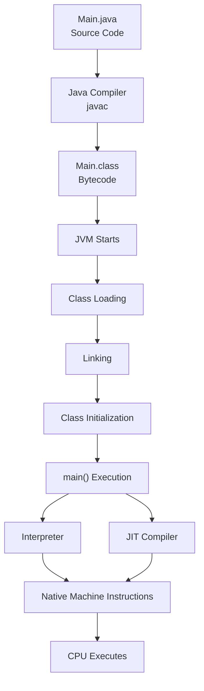
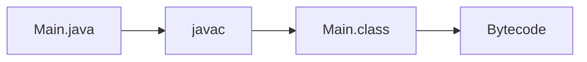
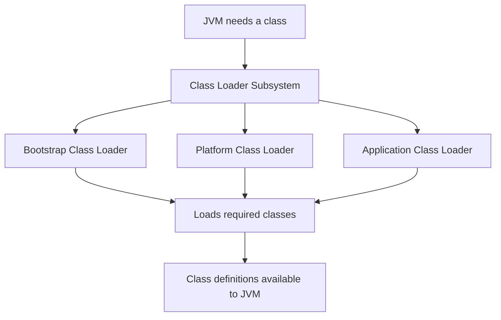
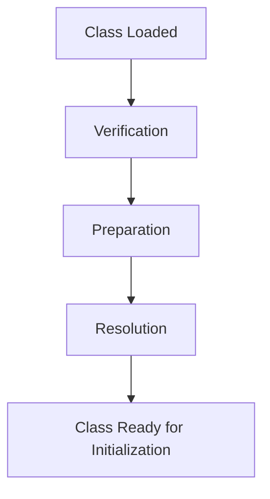
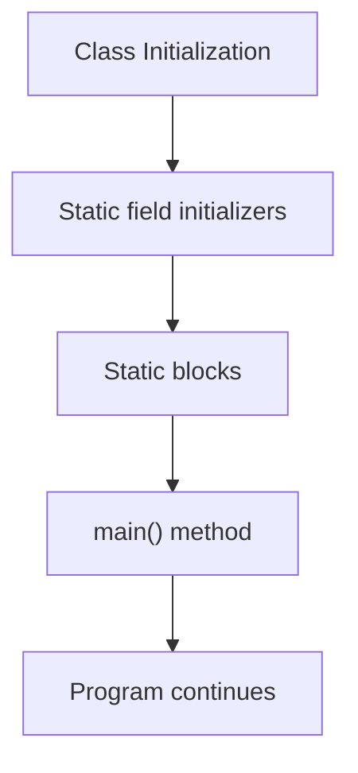
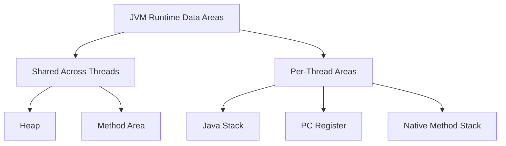
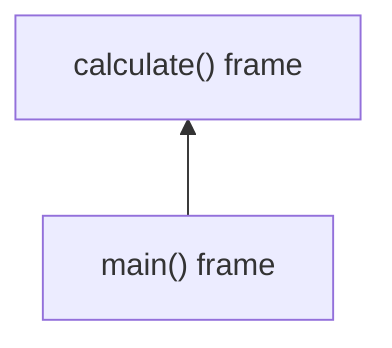
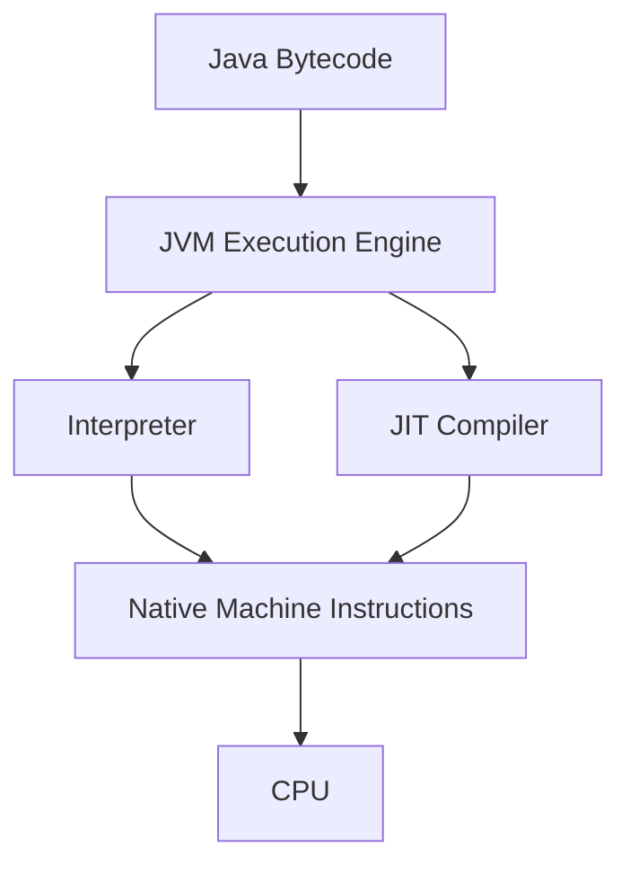
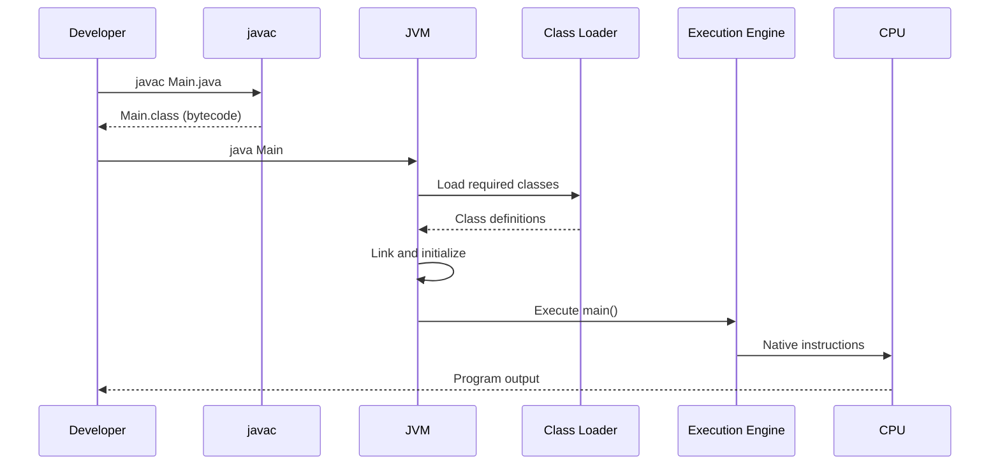

# Java Execution Flow

## 1. Introduction

When we write a Java program, the CPU cannot directly execute the Java source code.

The source code must pass through multiple stages before the program runs.

Let's understand what happens internally when we execute:

```bash
java Main
```

We will follow the journey from the `.java` file to actual CPU execution.

---

## 2. Complete Java Execution Flow

This is the high-level picture:



Let's understand each stage.

---

## 3. Step 1: Write Java Source Code

We begin by writing a Java program.

**Main.java**

```java
public class Main {

    public static void main(String[] args) {
        int a = 10;
        int b = 20;

        int result = a + b;

        System.out.println(result);
    }
}
```

This file contains human-readable Java source code.

The extension is:

```text
.java
```

---

## 4. Step 2: Compilation

We compile the source code using `javac`.

```bash
javac Main.java
```

The compiler checks the source code and generates bytecode.

```text
Main.java
    |
    | javac Main.java
    v
Main.class
```

The generated `.class` file contains Java bytecode.

### Visual representation



Important: Compilation does not normally generate a separate native executable for each operating system. It generates bytecode that a compatible JVM can execute.

---

## 5. Step 3: JVM Starts

Now execute:

```bash
java Main
```

This command launches the Java runtime and asks it to run the `Main` class.

**Important difference:**

- `javac Main.java` compiles the source file.
- `java Main` launches the JVM to execute the class.

The `java` command does not automatically compile `Main.java`.

---

## 6. Step 4: Class Loading

The Class Loader Subsystem loads the required class definitions into the JVM.

### Class Loader flow



The JVM uses a delegation model. A class loader may delegate a loading request to its parent before attempting to load the class itself.

The three commonly discussed built-in class loaders are:

| Class Loader | Responsibility |
|---|---|
| Bootstrap | Loads core Java runtime classes |
| Platform | Loads platform classes |
| Application | Loads application classes from the classpath/module path |

Classes are generally loaded when needed, rather than every class being loaded at JVM startup.

---

## 7. Step 5: Linking

After loading, the JVM links the class.

Linking has three main stages:

1. Verification
2. Preparation
3. Resolution

### Visual representation



### 7.1 Verification

The JVM checks whether the bytecode follows the required rules and is structurally valid.

For example, it checks bytecode validity and type-safety constraints.

### 7.2 Preparation

The JVM allocates memory for class-level static fields and assigns their default values.

For example:

```java
static int count = 100;
```

During preparation, the static field receives its default value of `0`. Its explicit initialization to `100` happens later during class initialization.

### 7.3 Resolution

Symbolic references in the class are resolved into references that the JVM can use.

For example, a reference to another class or method may need to be resolved.

Resolution can happen lazily, so it does not necessarily all happen immediately after preparation.

---

## 8. Step 6: Class Initialization

During initialization, the JVM executes class initialization logic, including static field initializers and static blocks.

Example:

```java
public class Main {

    static int value = 100;

    static {
        System.out.println("Static block executed");
    }

    public static void main(String[] args) {
        System.out.println(value);
    }
}
```

### Execution order



For this example, the output is:

```text
Static block executed
100
```

The main class is initialized before its `main()` method is invoked.

---

## 9. Step 7: JVM Runtime Data Areas

When the program runs, the JVM uses different memory areas.

### Visual representation



### Heap

The heap stores objects and arrays.

Example:

```java
Student student = new Student();
```

The `Student` object is allocated on the heap.

### Java Stack

Each thread has its own Java stack.

It stores method frames, including local variables and intermediate computation data.

Example:

```java
public static void main(String[] args) {
    int age = 25;
    calculate();
}

static void calculate() {
    int result = 10 + 20;
}
```

When `main()` calls `calculate()`, a new stack frame is created for `calculate()`.

When `calculate()` returns, its frame is removed.

### Stack visualization



The active method frame is at the top of the stack.

### Method Area

The Method Area is a JVM specification runtime area that stores class-level structures, such as runtime constant pools, method information, and field information.

In HotSpot JVM, class metadata is commonly stored in native memory called **Metaspace**.

### PC Register

Each JVM thread has its own program counter register, which tracks the current JVM instruction being executed. Its behavior differs while executing native methods.

### Native Method Stack

This supports execution of native methods, depending on the JVM implementation.

---

## 10. Step 8: Execution Engine

After the required classes are loaded and execution begins, the JVM's Execution Engine executes bytecode.

It commonly uses two important mechanisms:

- Interpreter
- Just-In-Time (JIT) Compiler

### Visual representation



The interpreter executes bytecode instructions.

The JIT compiler may compile frequently executed code into native machine code.

The JVM decides which execution strategy to use based on runtime behavior and implementation policies.

---

## 11. Step 9: CPU Execution

The CPU executes native machine instructions.

At this point, the processor performs the actual operations required by the program.

For example:

```java
int result = 10 + 20;
```

The JVM may execute or compile the corresponding bytecode into machine instructions that perform the addition.

---

## 12. What Happens When We Run `java Main`?

Let's connect the entire process:



This is a conceptual sequence. The JVM can load and resolve additional classes as execution progresses.

---

## 13. Practical Experiment

Create a file named `Main.java`:

```java
public class Main {

    static {
        System.out.println("1. Static block");
    }

    public static void main(String[] args) {
        System.out.println("2. Main method");
    }
}
```

Compile:

```bash
javac Main.java
```

Run:

```bash
java Main
```

Expected output:

```text
1. Static block
2. Main method
```

This demonstrates that class initialization occurs before the `main()` method executes.

---

## 14. Important Commands

| Command | Purpose |
|---|---|
| `javac Main.java` | Compiles Java source code |
| `java Main` | Launches JVM to execute the class |
| `java -version` | Displays Java runtime version |
| `javac -version` | Displays compiler version |
| `javap -c Main` | Displays bytecode instructions |

---

## 15. Common Misconceptions

1. **`java Main` compiles the source code.**  
   Incorrect. It launches the JVM to execute the class.

2. **All classes are loaded when the JVM starts.**  
   Incorrect. Classes are generally loaded as required.

3. **Static fields receive their explicit values during preparation.**  
   Incorrect. Preparation assigns default values; explicit initializers execute during class initialization.

4. **All bytecode is immediately converted into native code.**  
   Incorrect. The JVM can interpret bytecode and selectively JIT-compile code.

5. **Heap and stack are the same memory area.**  
   Incorrect. They serve different purposes and have different allocation and lifetime characteristics.

---

## 16. Interview Questions

**Q1. What happens internally when you execute `java Main`?**

The Java launcher starts the JVM, which loads the main class and required dependencies, performs linking and initialization as required, and invokes the `main()` method. The execution engine interprets or JIT-compiles bytecode.

**Q2. What are the stages of linking?**

Verification, preparation, and resolution.

**Q3. What is the difference between class loading and class initialization?**

Loading brings a class definition into the JVM. Initialization executes its static initialization logic.

**Q4. What is the difference between heap and stack?**

The heap stores objects and arrays, while each thread's Java stack stores method frames and local execution data.

**Q5. Does JVM execute bytecode directly on the CPU?**

No. The JVM interprets bytecode or compiles selected bytecode into native machine instructions that the CPU can execute.

---

## 17. Quick Revision

```text
Java Source Code
      |
      v
   javac
      |
      v
 Java Bytecode
      |
      v
   JVM Starts
      |
      v
 Class Loading
      |
      v
    Linking
      |
      v
Class Initialization
      |
      v
  main() Method
      |
      v
Execution Engine
      |
      v
 Interpreter / JIT
      |
      v
Native Machine Instructions
      |
      v
     CPU
```

## 18. Check Your Understanding

You should be able to explain:

- Why Java source code needs compilation.
- What bytecode is.
- What happens when `java Main` runs.
- What class loading, linking, and initialization mean.
- Why the JVM needs runtime data areas.
- How the interpreter and JIT work together.

## 19. Related Topics

- [JVM](../03-Java-Platform/jvm.md)
- [JVM vs JRE vs JDK](../03-Java-Platform/jvm-vs-jre-vs-jdk.md)
- [Compiler vs Interpreter](./compiler-vs-interpreter.md)
- [JIT Compiler](./jit-compiler.md)
- [Runtime Data Areas](../05-JVM-Architecture/runtime-data-areas.md)

