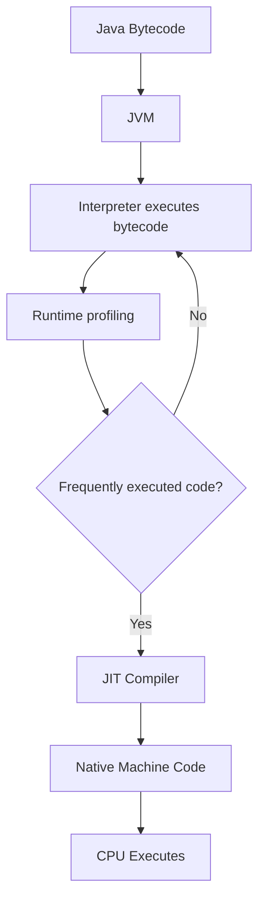
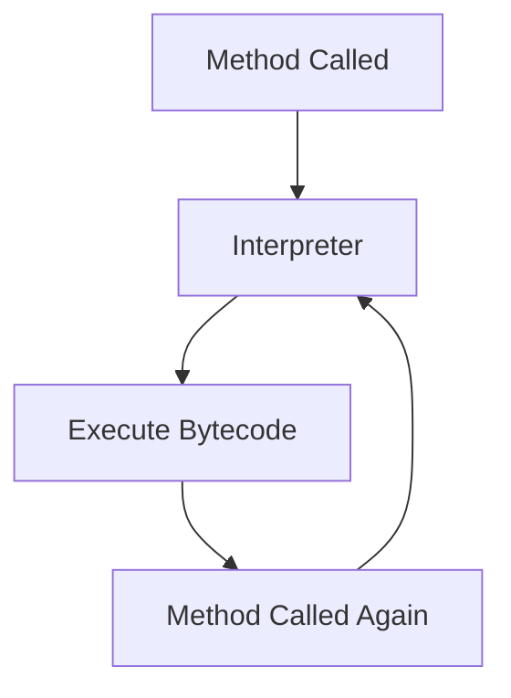
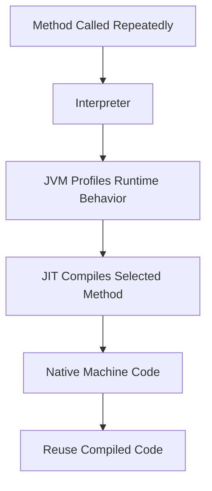
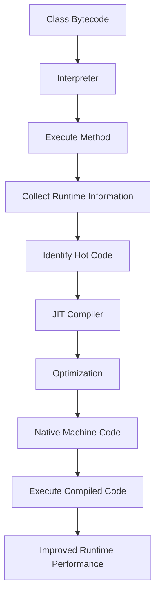
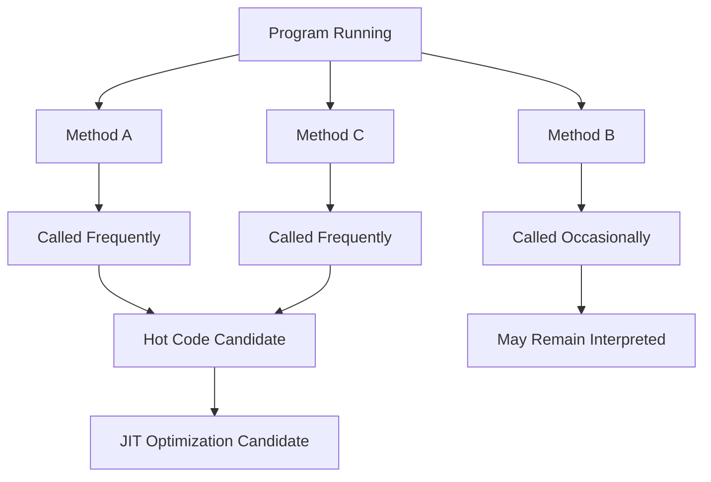
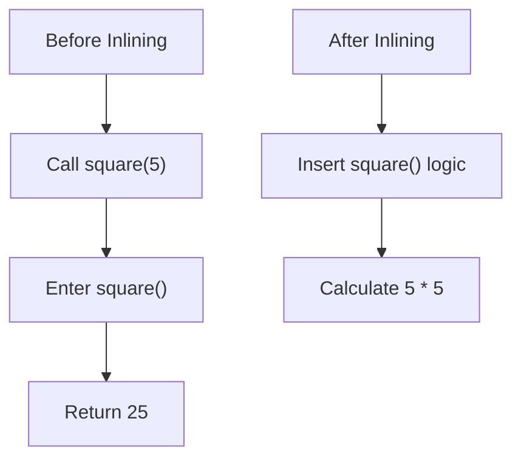
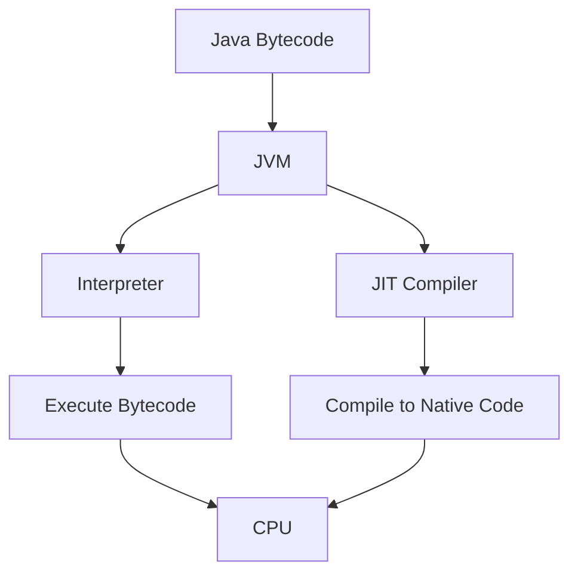
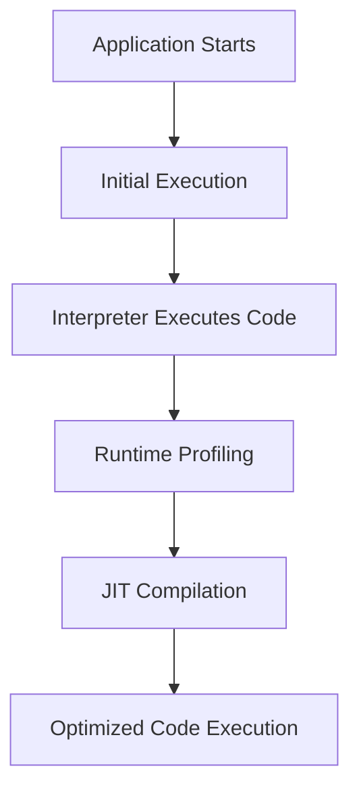
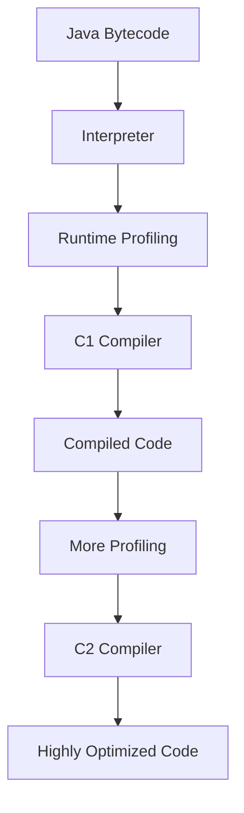
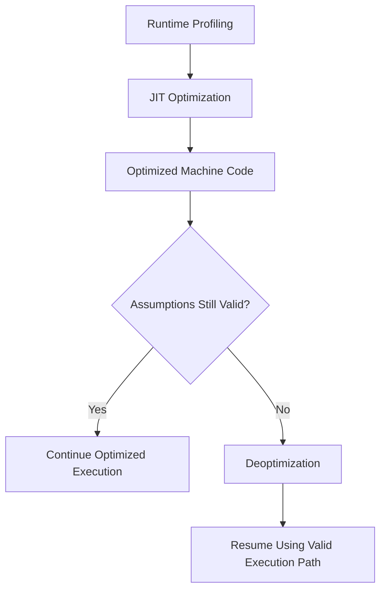

# JIT Compiler (Just-In-Time Compiler)

## 1. Introduction

Java source code is compiled into bytecode. The JVM can execute this bytecode using an interpreter.

But interpreting every instruction repeatedly can introduce execution overhead.

This is where the **JIT (Just-In-Time) Compiler** comes into the picture.

The JIT compiler improves performance by compiling selected frequently executed bytecode into native machine code at runtime.

---

## 2. What is JIT Compilation?

JIT stands for **Just-In-Time**.

It means that compilation happens during program execution, when the JVM determines that compiling certain code may improve performance.

Instead of interpreting the same frequently executed code repeatedly, the JVM can compile it into native machine code and reuse the compiled version.

### Visual representation



The diagram illustrates a common execution model. Actual compilation decisions depend on the JVM implementation and its optimization policies.

---

## 3. Why Do We Need a JIT Compiler?

Imagine a method that is called thousands or millions of times.

If the JVM interprets the same bytecode every time, it repeatedly performs the work of decoding and executing those instructions.

The JIT compiler can optimize this situation.

### Without JIT



The interpreter continues executing the bytecode.

### With JIT



The compiled code can be reused when the method is called again, avoiding repeated interpretation of that code.

---

## 4. How Does the JIT Compiler Work?

Let's understand the process step by step.

### Step 1: Bytecode execution begins

The JVM loads the required classes and begins executing their bytecode.

### Step 2: Interpreter executes instructions

The interpreter executes bytecode instructions.

### Step 3: Runtime profiling

The JVM observes runtime behavior.

For example:

- How frequently a method is called.
- How often a loop executes.
- Which code paths are commonly used.
- What types of objects are encountered.

### Step 4: Identify frequently executed code

The JVM may identify methods or loops that are executed frequently.

Such code is commonly referred to as *hot code*.

### Step 5: JIT compilation

The JIT compiler compiles selected bytecode into native machine code.

### Step 6: Execute optimized code

The JVM can use the compiled machine code when that code runs again.

### Complete flow



---

## 5. Example: Frequently Called Method

Consider this Java program:

```java
public class Main {

    static int calculate(int a, int b) {
        return a + b;
    }

    public static void main(String[] args) {

        for (int i = 0; i < 1_000_000; i++) {
            calculate(i, 10);
        }

        System.out.println("Execution completed");
    }
}
```

The method `calculate()` is called repeatedly.

The JVM can observe this runtime behavior and may decide to JIT-compile the method or optimize the surrounding code.

**Important:** This example illustrates the idea, not a guarantee that this exact method will be compiled independently. A JVM may inline it or optimize the loop and surrounding code instead.

---

## 6. What is Hot Code?

Hot code refers to code that executes frequently enough to become a candidate for runtime optimization.

For example:

```java
for (int i = 0; i < 1_000_000; i++) {
    calculate(i, 10);
}
```

The loop and the method called inside it may become candidates for optimization.

### Visual representation



Not every frequently executed method is necessarily compiled. The JVM considers multiple factors when making compilation decisions.

---

## 7. Common JIT Optimizations

The JIT compiler can apply several optimizations.

### 7.1 Method Inlining

Instead of performing a normal method call, the compiler may insert the method's body directly into the caller.

For example:

```java
static int square(int x) {
    return x * x;
}

public static void main(String[] args) {
    int result = square(5);
}
```

Conceptually, the optimized code may behave like:

```java
int result = 5 * 5;
```

This can reduce method-call overhead.

### Visual representation



This is a conceptual illustration. Actual optimized machine code may look different.

### 7.2 Loop Optimization

The JIT compiler can optimize frequently executed loops.

For example, it may apply loop transformations that reduce repeated work.

### 7.3 Dead Code Elimination

Code that cannot affect the observable result may be removed.

### 7.4 Constant Folding

Expressions with values known during compilation may be evaluated early.

For example:

```java
int result = 10 * 20;
```

A compiler may replace the expression with:

```java
int result = 200;
```

Constant folding can happen during ordinary compilation or JIT compilation, depending on the expression and compiler.

### 7.5 Runtime Profiling

The JVM can use information collected during execution to make optimization decisions.

For example, it may observe that a particular method call usually receives objects of one concrete type.

It can optimize based on that observation, while retaining mechanisms to handle cases where its assumptions stop being valid.

---

## 8. Interpreter vs JIT Compiler

| Aspect | Interpreter | JIT Compiler |
|---|---|---|
| Main role | Executes bytecode | Compiles selected bytecode |
| When it works | During runtime | During runtime |
| Output | Executes bytecode instructions | Produces native machine code |
| Runtime overhead | Repeated interpretation work | Compilation has an initial cost |
| Performance | Useful for initial execution | Can improve performance of hot code |

### Visual comparison



The interpreter and JIT are not competing alternatives in the usual JVM execution model. They can work together.

---

## 9. JVM Warm-up

Have you ever noticed that a Java application may take some time to reach its best performance?

One reason is JIT compilation.

Initially, code may be interpreted. As the JVM gathers runtime information, it can compile and optimize frequently executed code.

This process is commonly called **JVM warm-up**.

### Visual representation



This is why benchmarks should account for JVM warm-up rather than measuring only the first few executions.

---

## 10. Compilation Overhead

JIT compilation itself takes time and resources.

For example:

- The JVM spends CPU time compiling code.
- It needs memory for compiled machine code and profiling information.
- Initial execution may be slower while the JVM is warming up.

However, for long-running applications, the performance benefits can outweigh the compilation overhead.

---

## 11. Tiered Compilation in HotSpot JVM

HotSpot commonly uses tiered compilation.

A simplified explanation:

- **C1 compiler:** A faster compiler that performs relatively quick compilation with lighter optimization.
- **C2 compiler:** A more optimizing compiler that spends more effort generating highly optimized code.

### Visual representation



This is a simplified model of HotSpot tiered compilation. Not every method necessarily passes through every tier.

---

## 12. What is Deoptimization?

JIT compilers sometimes optimize code using assumptions based on runtime observations.

For example, the JVM may observe that a particular method receives objects of a specific type most of the time.

It may optimize the code based on that assumption.

But what happens if a different type appears later?

The JVM can invalidate the optimization and return execution to a less optimized form. This is called **deoptimization**.

### Visual representation



Deoptimization helps the JVM preserve correct program behavior even when runtime assumptions change.

---

## 13. JIT vs AOT Compilation

AOT stands for **Ahead-Of-Time** compilation.

| Aspect | JIT | AOT |
|---|---|---|
| Compilation timing | During runtime | Before runtime |
| Runtime information | Can use profiling data | Usually has less information about actual runtime behavior |
| Startup cost | May include compilation overhead | Can reduce some runtime compilation overhead |
| Optimization | Can use observed runtime behavior | Optimizes before execution |
| Example | HotSpot JIT | GraalVM Native Image |

AOT and JIT are different compilation strategies. Java ecosystems can use both, depending on the deployment and runtime setup.

---

## 14. Common Misconceptions

1. **JIT compiles the entire application immediately.**  
   Incorrect. JIT compilation is selective and runtime-dependent.

2. **JIT works before the program starts.**  
   Incorrect. JIT compilation happens during runtime.

3. **The interpreter becomes completely unnecessary when JIT is enabled.**  
   Incorrect. The JVM can use interpretation and JIT compilation together.

4. **JIT always makes the application faster from the first instruction.**  
   Incorrect. Compilation has overhead, and performance benefits may appear after warm-up.

5. **Every Java method is compiled by C2.**  
   Incorrect. Compilation depends on JVM policies and runtime behavior.

---

## 15. Interview Questions

### Beginner

**Q1. What is JIT?**

JIT is a runtime compiler that compiles selected bytecode into native machine code to improve execution performance.

**Q2. Why does Java need JIT?**

JIT can reduce repeated interpretation overhead for frequently executed code.

**Q3. What is hot code?**

Code that executes frequently and may become a candidate for JIT compilation.

### Intermediate

**Q4. What is JVM warm-up?**

The initial execution period during which the JVM gathers profiling information and may compile and optimize frequently executed code.

**Q5. What is method inlining?**

An optimization where the compiler inserts a method's logic into its caller instead of performing a normal method call.

**Q6. What is deoptimization?**

The process of invalidating an optimization when its assumptions no longer hold and resuming execution through a valid path.

**Q7. What is tiered compilation?**

A HotSpot strategy that uses different compilation levels, commonly involving C1 and C2, to balance compilation speed and optimization quality.

---

## 16. Practical Thinking Questions

1. Why might a Java application perform differently during its first few seconds compared with later execution?
2. Why does JIT compilation consume CPU resources?
3. Why shouldn't we assume that every method will be JIT-compiled?
4. What happens if an optimization's assumptions become invalid?
5. Why might AOT compilation help an application with strict startup requirements?

---

## 17. Quick Revision

| Term | Meaning |
|---|---|
| JIT | Just-In-Time compiler |
| Hot Code | Frequently executed code |
| Runtime Profiling | Observing program behavior during execution |
| Method Inlining | Inserting method logic into the caller |
| Deoptimization | Invalidating an optimization when assumptions fail |
| Warm-up | Initial runtime period when profiling and optimization may occur |
| C1 | HotSpot compiler focused on relatively quick compilation |
| C2 | HotSpot optimizing compiler |
| AOT | Ahead-Of-Time compilation |

### Complete JIT flow

```text
Java Bytecode
     |
     v
Interpreter
     |
     v
Runtime Profiling
     |
     v
Identify Hot Code
     |
     v
JIT Compiler
     |
     v
Optimization
     |
     v
Native Machine Code
     |
     v
CPU Executes
```

## 18. Check Your Understanding

You should be able to explain:

- Why JIT is needed.
- What hot code means.
- How runtime profiling works.
- How method inlining improves performance.
- Why JVM warm-up happens.
- What C1 and C2 do in HotSpot.
- What deoptimization means.
- How JIT differs from AOT.

## 19. Related Topics

- [Compiler vs Interpreter](./compiler-vs-interpreter.md)
- [Java Execution Flow](./java-execution-flow.md)
- [JVM](../03-Java-Platform/jvm.md)
- [Execution Engine](../05-JVM-Architecture/execution-engine.md)

