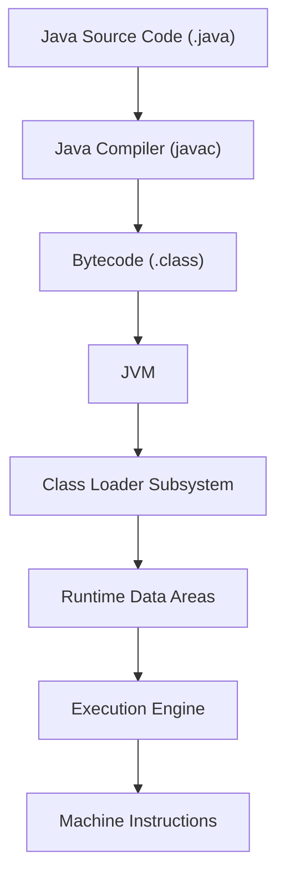
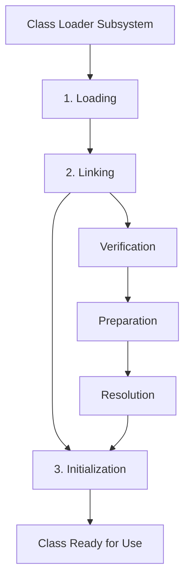
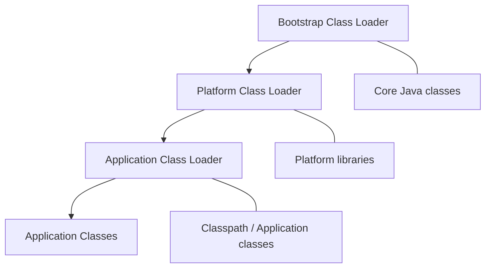
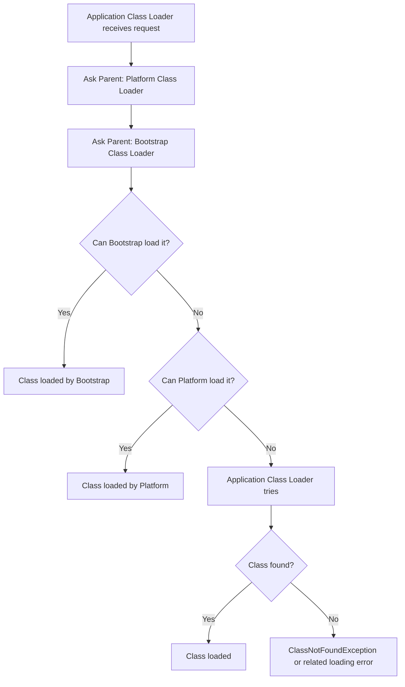
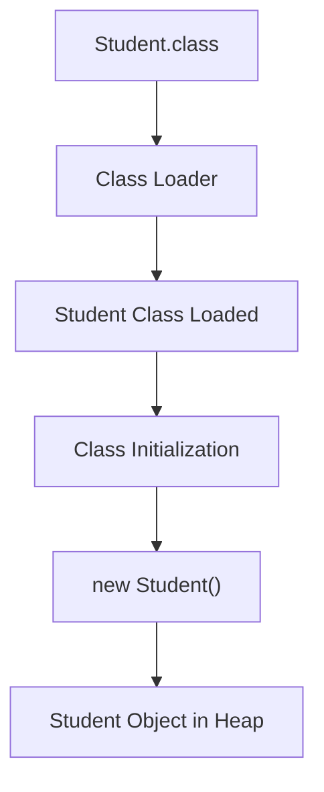

# Java Class Loader

## 1. What is a Class Loader?

A **Class Loader** is a component of the JVM responsible for loading Java class files (`.class`) into memory when they are needed by a Java application.

When we compile a Java source file:

```bash
javac Main.java
```

The compiler generates:

```text
Main.class
```

But generating a `.class` file does not mean that the class is already loaded into JVM memory.

The JVM uses the **Class Loader Subsystem** to load the class when required during execution.

### Simple definition

A Class Loader finds the required class bytecode, loads it into the JVM, and makes it available for execution.

---

## 2. Where does the Class Loader fit in JVM architecture?



The Class Loader is the entry point for bringing class definitions into the JVM runtime.

---

## 3. How does Class Loading work?

The Class Loader Subsystem performs three major phases:

1. Loading
2. Linking
3. Initialization



Let's understand each phase.

### 3.1 Loading

During loading, the JVM:

- Finds the required `.class` file or obtains its bytecode from another source.
- Reads the class bytecode.
- Creates the runtime representation of the class.
- Creates a `Class` object representing that class.

Example:

```java
public class Student {
    String name;
    int age;
}
```

When the JVM loads `Student`, it creates the runtime representation needed to work with that class.

Important: Loading does not mean creating an object of the class.

### 3.2 Linking

Linking prepares the loaded class for execution.

It has three sub-phases.

#### A. Verification

The JVM checks whether the bytecode is structurally valid and follows JVM rules.

Examples of checks:

- Is the bytecode properly formatted?
- Are instructions valid?
- Are operations type-safe?
- Does the bytecode violate JVM verification rules?

This helps prevent invalid or malformed bytecode from being executed.

#### B. Preparation

The JVM allocates memory for class-level static fields and assigns their default values.

Example:

```java
class Student {
    static int count = 10;
}
```

During preparation, `count` receives its default value:

```text
count = 0
```

The explicit assignment of `10` happens during initialization.

#### C. Resolution

The JVM replaces symbolic references with direct references where required.

For example, bytecode may refer to another class using its symbolic name. Resolution connects that reference to the corresponding runtime entity.

Resolution can happen lazily, as the JVM needs the referenced entities.

### 3.3 Initialization

During initialization, the JVM executes class initialization code.

This includes:

- Explicit static field initializers.
- Static initialization blocks.

Example:

```java
class Student {

    static int count = 10;

    static {
        System.out.println("Student class initialized");
    }
}
```

The static initialization code runs when the class is initialized.

The JVM does not necessarily initialize every loaded class immediately. Initialization generally occurs when an active use of the class requires it.

---

## 4. Types of Class Loaders

Java provides a delegation-based class-loading mechanism.

The three commonly discussed built-in class loaders are:

1. Bootstrap Class Loader
2. Platform Class Loader
3. Application Class Loader

### Class Loader hierarchy



### 4.1 Bootstrap Class Loader

The Bootstrap Class Loader loads fundamental Java runtime classes.

Examples include classes from the `java.lang` package, such as:

- `String`
- `Object`
- `System`
- `Class`

It is commonly implemented using native or platform-specific JVM code.

In typical Java code, its `ClassLoader` representation is `null`.

### 4.2 Platform Class Loader

The Platform Class Loader loads platform classes and libraries made available by the Java runtime.

It replaced the older Extension Class Loader terminology in modern Java.

### 4.3 Application Class Loader

The Application Class Loader loads application classes from the classpath or application module path.

Example:

```java
public class Main {
    public static void main(String[] args) {
        System.out.println("Hello Java");
    }
}
```

When the application starts, the Application Class Loader is typically responsible for loading `Main`.

---

## 5. Parent Delegation Model

Java class loaders commonly follow the **Parent Delegation Model**.

Before a class loader attempts to load a class itself, it delegates the request to its parent.

### Visual representation



### Why does Java use parent delegation?

It helps:

- Avoid duplicate loading of core Java classes.
- Maintain consistency in class identity.
- Prevent application classes from casually replacing fundamental runtime classes.
- Improve security and reliability.

For example, an application should not be able to replace the JVM's fundamental `java.lang.String` class simply by placing another class with the same name on its classpath.

---

## 6. Class Loader Example

```java
public class Main {

    public static void main(String[] args) {

        ClassLoader loader = Main.class.getClassLoader();

        System.out.println(loader);

        System.out.println(
            String.class.getClassLoader()
        );
    }
}
```

Possible output:

```text
jdk.internal.loader.ClassLoaders$AppClassLoader@...
null
```

Why?

- `Main` is generally loaded by the Application Class Loader.
- `String` is loaded by the Bootstrap Class Loader.
- The Bootstrap Class Loader is represented as `null` through this API.

The exact class-loader implementation name can vary between Java versions and JVM implementations.

---

## 7. Class Loader vs Object Creation

These are two different operations.



| Class Loading | Object Creation |
|---|---|
| Loads class definition | Creates an instance |
| Performed by Class Loader | Performed when object creation occurs |
| Establishes runtime class representation | Allocates object memory |
| Does not create every object | Creates a particular object |

Example:

```java
Student s1 = new Student();
Student s2 = new Student();
```

The class definition can be loaded once by a particular class loader, while multiple objects can be created from it.

---

## 8. Can we create a custom Class Loader?

Yes.

Java allows developers to create custom class loaders by extending `ClassLoader`.

Common use cases include:

- Plugin systems.
- Application servers.
- Loading classes from custom locations.
- Frameworks that isolate different application modules.
- Dynamic loading of classes.

Example skeleton:

```java
class MyClassLoader extends ClassLoader {

    // Override findClass() when implementing
    // custom class-loading behavior.
}
```

A real custom class loader must correctly locate, read, and define class bytecode. Simply extending `ClassLoader` does not automatically implement that behavior.

---

## 9. Important Interview Questions

### Q1. What is a Class Loader?

A JVM component that loads class definitions into memory when required.

### Q2. What are the three main built-in Class Loaders?

- Bootstrap
- Platform
- Application

### Q3. What is parent delegation?

A mechanism where a class loader delegates class-loading requests to its parent before attempting to load the class itself.

### Q4. Does loading a class create its object?

No. Class loading establishes the runtime class representation. Objects are created separately.

### Q5. What are the three phases of class loading?

- Loading
- Linking
- Initialization

### Q6. What happens during preparation?

Memory is allocated for static fields and they receive default values.

### Q7. When does static initialization happen?

When the class is initialized, not merely because a `.class` file exists.

### Q8. Why is Bootstrap Class Loader represented as null?

It is implemented as part of the JVM runtime rather than as an ordinary Java `ClassLoader` object exposed through that API.

---

## 10. Practice Questions

1. What is the difference between loading and initialization?
2. Why does `String.class.getClassLoader()` return `null`?
3. Can two different Class Loaders load a class having the same fully qualified name?
4. What happens if a required class cannot be found?
5. Why does Java use parent delegation?
6. What is the difference between `ClassNotFoundException` and `NoClassDefFoundError`?

---

## 11. Quick Revision

| Concept | Meaning |
|---|---|
| Class Loader | Loads class definitions into JVM |
| Loading | Reads bytecode and creates runtime class representation |
| Linking | Verifies and prepares the class, then resolves references |
| Verification | Checks bytecode validity |
| Preparation | Allocates static fields and gives default values |
| Resolution | Converts symbolic references into direct references |
| Initialization | Executes static initialization code |
| Bootstrap | Loads core runtime classes |
| Platform | Loads platform classes |
| Application | Loads application classes |
| Parent Delegation | Delegates loading to parent first |

---

## 12. Check Your Understanding

I should be able to explain:

- [ ] What a Class Loader does.
- [ ] Why `.class` files are not automatically loaded into memory.
- [ ] Loading, linking, and initialization.
- [ ] Verification, preparation, and resolution.
- [ ] The three built-in Class Loaders.
- [ ] Parent Delegation Model.
- [ ] Class loading vs object creation.
- [ ] Why custom Class Loaders are useful.

## Related Topics

- [JVM](../03-Java-Platform/jvm.md)
- [JRE](../03-Java-Platform/jre.md)
- [Java Execution Flow](../04-Java-Execution/java-execution-flow.md)
- [Runtime Data Areas](runtime-data-areas.md)
- [Execution Engine](execution-engine.md)