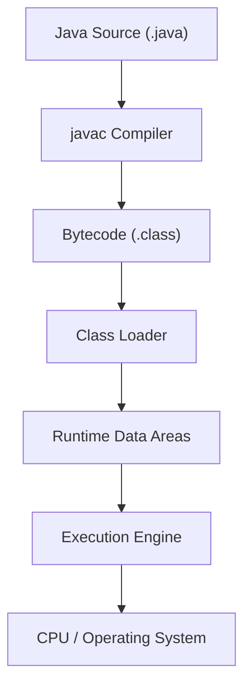
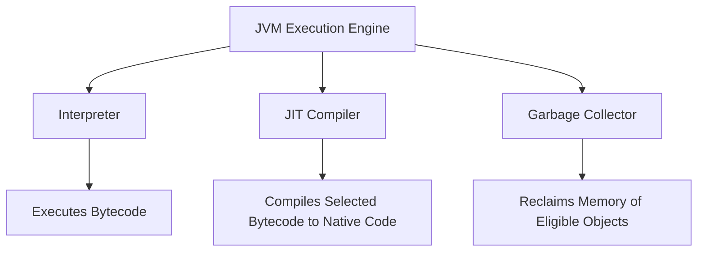
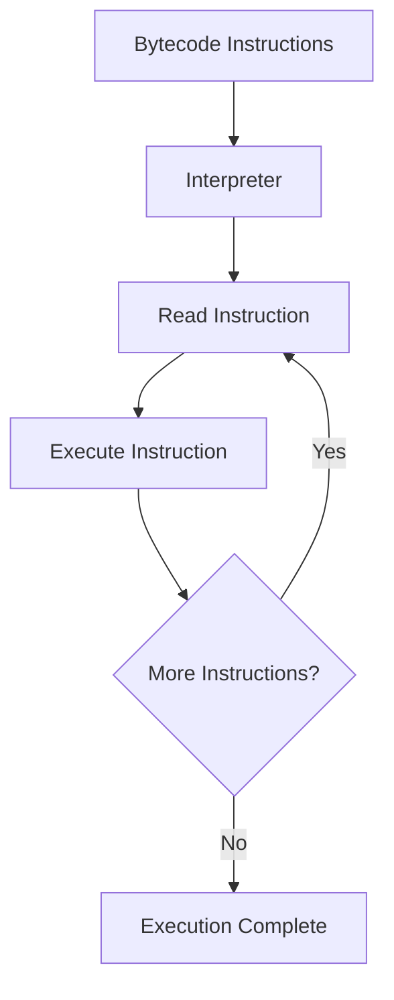
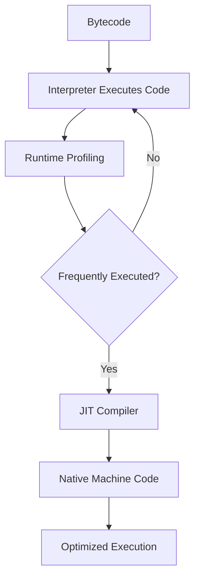
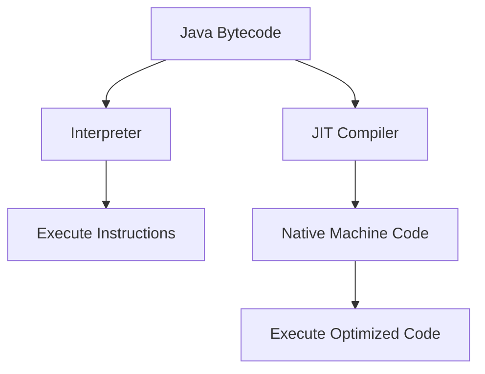
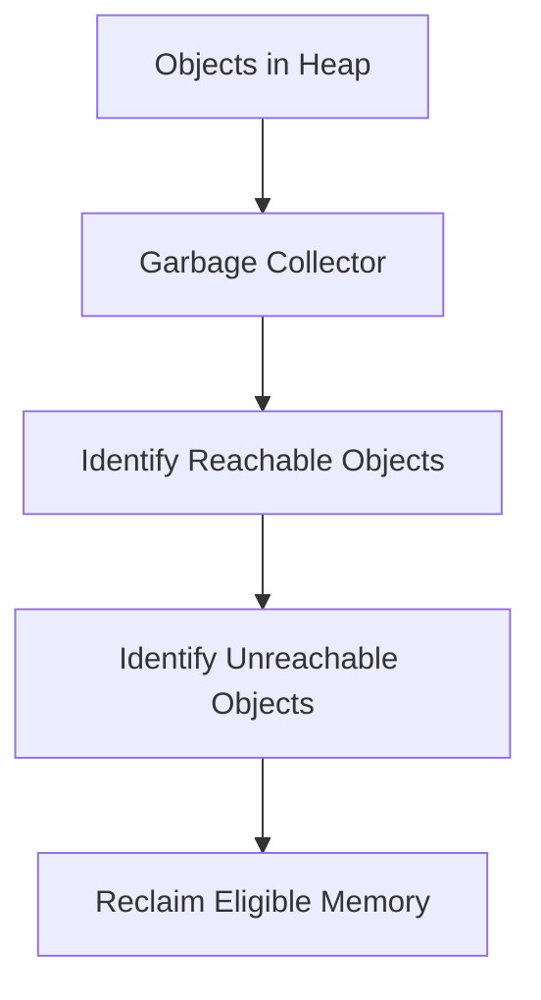
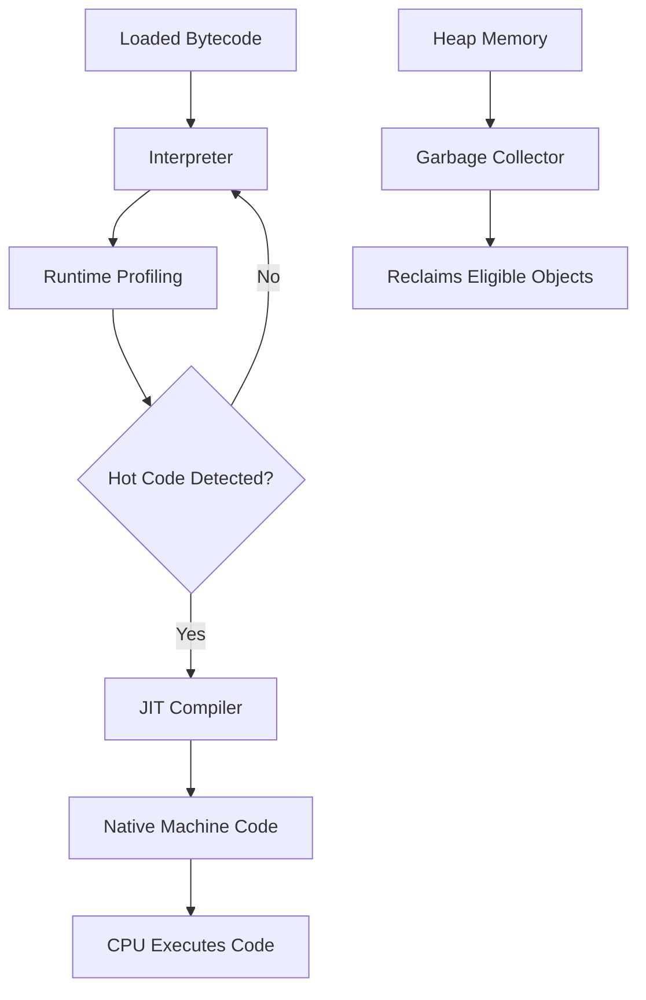
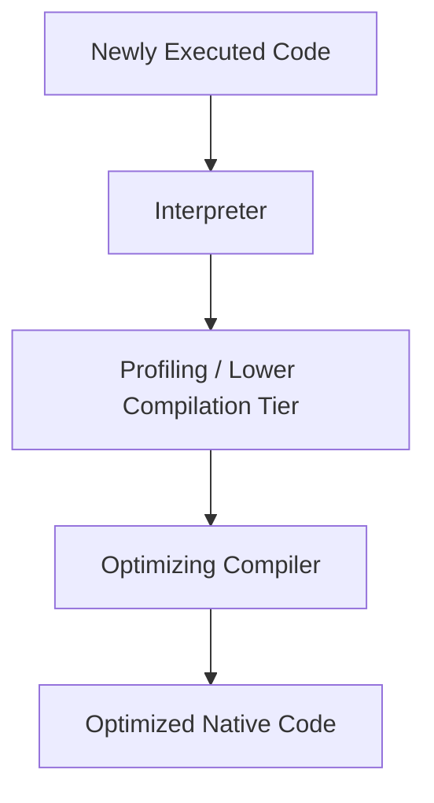

# JVM Execution Engine

## 1. What is the Execution Engine?

The **Execution Engine** is the JVM component responsible for executing the bytecode loaded into the JVM.

The Java compiler (`javac`) converts Java source code into bytecode. However, the CPU does not directly execute JVM bytecode.

The Execution Engine makes that bytecode executable on the underlying machine.

### Simple definition

The Execution Engine executes Java bytecode using mechanisms such as interpretation and Just-In-Time (JIT) compilation.

---

## 2. Where does the Execution Engine fit in JVM architecture?



The Execution Engine works with the runtime data areas and executes the bytecode of loaded classes.

---

## 3. Main Components of the Execution Engine

The commonly discussed components are:

1. Interpreter
2. Just-In-Time (JIT) Compiler
3. Garbage Collector



The garbage collector is part of JVM runtime memory management and is often discussed alongside the execution engine. Its exact implementation and relationship to other JVM components are implementation-specific.

---

## 4. Interpreter

The Interpreter executes bytecode instructions at runtime.

It reads instructions and performs the corresponding operations.

Example:

```java
public class Main {

    public static void main(String[] args) {

        int a = 10;
        int b = 20;

        int sum = a + b;

        System.out.println(sum);
    }
}
```

The compiler converts this source code into bytecode. The interpreter can execute those bytecode instructions.

### Interpreter flow



### Advantages

- Can start executing code without compiling every method into native code first.
- Useful for methods that execute only a few times.
- Supports dynamic runtime behavior.

### Limitation

Repeatedly interpreting frequently executed code can be less efficient than executing optimized native machine code.

---

## 5. JIT Compiler

JIT stands for **Just-In-Time Compiler**.

The JIT compiler compiles selected frequently executed bytecode into native machine code at runtime.

This allows the JVM to optimize important code paths.

### Why do we need JIT?

Imagine a method that is called thousands of times.

```java
public class Main {

    static int calculate(int a, int b) {
        return a + b;
    }

    public static void main(String[] args) {

        for (int i = 0; i < 100000; i++) {
            calculate(i, 10);
        }
    }
}
```

The JVM can observe that `calculate()` is frequently executed.

Depending on the JVM's compilation policy, it may compile the method into native machine code.

### JIT flow



### Common JIT optimizations

- Method inlining.
- Loop optimizations.
- Dead code elimination.
- Constant folding.
- Runtime profiling-based optimizations.

The actual optimizations depend on the JVM implementation and runtime conditions.

---

## 6. Interpreter vs JIT Compiler

| Interpreter | JIT Compiler |
|---|---|
| Executes bytecode at runtime | Compiles selected bytecode into native code |
| Can begin execution quickly | May require compilation time |
| Does not need to compile every method into native code | Focuses on selected code paths |
| Repeated execution can be less efficient | Can improve performance of frequently executed code |

### Visual comparison



---

## 7. What is Runtime Profiling?

Runtime profiling means collecting information about how the application behaves while it runs.

The JVM may observe:

- How frequently a method is called.
- Which branches are commonly executed.
- Which types appear at particular call sites.
- How loops behave.

This information can help the JIT compiler decide what to optimize.

For example, if one method is called repeatedly with similar runtime behavior, the JVM may optimize it based on observed patterns.

---

## 8. What is Method Inlining?

Method inlining is an optimization where the JIT compiler replaces a method call with the method's body when appropriate.

Original code:

```java
static int add(int a, int b) {
    return a + b;
}

static int calculate() {
    return add(10, 20);
}
```

Conceptual inlined version:

```java
static int calculate() {
    return 10 + 20;
}
```

This is a simplified illustration of the optimization. Actual machine-code optimization is more complex.

Potential benefit:

- Reduces method-call overhead.
- Gives the compiler more opportunity to optimize surrounding code.

---

## 9. What is JVM Warm-up?

A Java application may not reach its best optimized performance immediately after startup.

Initially, code may execute through interpretation or less optimized compilation.

As the JVM observes runtime behavior, it can compile frequently executed code and apply optimizations.

This process is commonly called **JVM warm-up**.


This is why Java benchmarking must account for warm-up and avoid measuring only the first execution.

---

## 10. Garbage Collector

Garbage Collection is the JVM's automatic memory-management mechanism.

It reclaims heap memory occupied by objects that are no longer reachable.

Example:

```java
Student student = new Student();

student = null;
```

If no other reachable reference points to the object, it may become eligible for garbage collection.

### GC flow



Important:

- GC does not guarantee immediate object destruction.
- Developers do not normally manually free Java objects.
- GC behavior depends on the selected collector and JVM implementation.

---

## 11. Complete Execution Engine Flow

Let's combine the components.



This is a simplified conceptual model. Real JVM implementations can use tiered compilation, deoptimization, multiple compiler threads, and different execution strategies.

---

## 12. HotSpot Tiered Compilation

HotSpot is a widely used JVM implementation.

It supports tiered compilation, where code can move through different compilation levels.

A simplified view:



In HotSpot, C1 and C2 are commonly discussed compiler components:

- **C1:** Faster compilation, often used for quicker optimization.
- **C2:** More aggressive optimization, often used for code that becomes sufficiently hot.

The exact tier transitions depend on runtime configuration and JVM version.

---

## 13. JIT vs AOT Compilation

AOT stands for **Ahead-Of-Time Compilation**.

| JIT | AOT |
|---|---|
| Compiles during runtime | Compiles before runtime |
| Can use runtime profiling | Has less runtime profiling information at compilation time |
| May have warm-up overhead | Can reduce runtime compilation overhead |
| Can optimize based on observed behavior | Optimizations depend on information available before execution |

Java ecosystems also support AOT-related technologies. They do not replace the traditional JVM execution model in every application.

---

## 14. Interview Questions

### Q1. What is the Execution Engine?

The JVM component that executes bytecode using interpretation and compilation mechanisms.

### Q2. What is the difference between Interpreter and JIT?

The Interpreter executes bytecode instructions, while JIT compiles selected bytecode into native machine code.

### Q3. Why does Java use both Interpreter and JIT?

Interpretation supports quick initial execution, while JIT compilation can improve performance for frequently executed code.

### Q4. What is hot code?

Code that executes frequently enough to become a candidate for runtime optimization.

### Q5. What is JVM warm-up?

The period during which the JVM collects runtime information and may compile and optimize frequently executed code.

### Q6. What is method inlining?

An optimization that replaces a method call with the method's body when appropriate.

### Q7. Does JIT compile every Java method?

No. It typically compiles selected methods or code paths according to runtime policies.

### Q8. What is Garbage Collection?

Automatic reclamation of heap memory occupied by unreachable objects.

---

## 15. Practice Questions

1. Why can't a CPU directly execute Java bytecode?
2. Why does the JVM need an Interpreter?
3. Why does the JVM need a JIT Compiler?
4. What is runtime profiling?
5. What is hot code?
6. Why can a Java application become faster after warm-up?
7. What is method inlining?
8. What is the difference between JIT and AOT?
9. Does the JIT compiler compile every method?
10. How does Garbage Collection help memory management?

---

## 16. Quick Revision

| Component | Responsibility |
|---|---|
| Interpreter | Executes bytecode |
| JIT Compiler | Compiles selected bytecode into native code |
| Runtime Profiler | Collects runtime behavior information |
| Garbage Collector | Reclaims memory of eligible objects |
| C1 | HotSpot compiler tier focused on quicker compilation |
| C2 | HotSpot optimizing compiler |

## 17. Check Your Understanding

- [ ] Explain the Execution Engine.
- [ ] Explain Interpreter vs JIT.
- [ ] Explain runtime profiling.
- [ ] Explain hot code.
- [ ] Explain method inlining.
- [ ] Explain JVM warm-up.
- [ ] Explain Garbage Collection.
- [ ] Explain JIT vs AOT.
- [ ] Explain the simplified HotSpot tiered compilation model.

## Related Topics

- [JVM](../03-Java-Platform/jvm.md)
- [Compiler vs Interpreter](../04-Java-Execution/compiler-vs-interpreter.md)
- [Java Execution Flow](../04-Java-Execution/java-execution-flow.md)
- [JIT Compiler](../04-Java-Execution/jit-compiler.md)
- [Runtime Data Areas](runtime-data-areas.md)