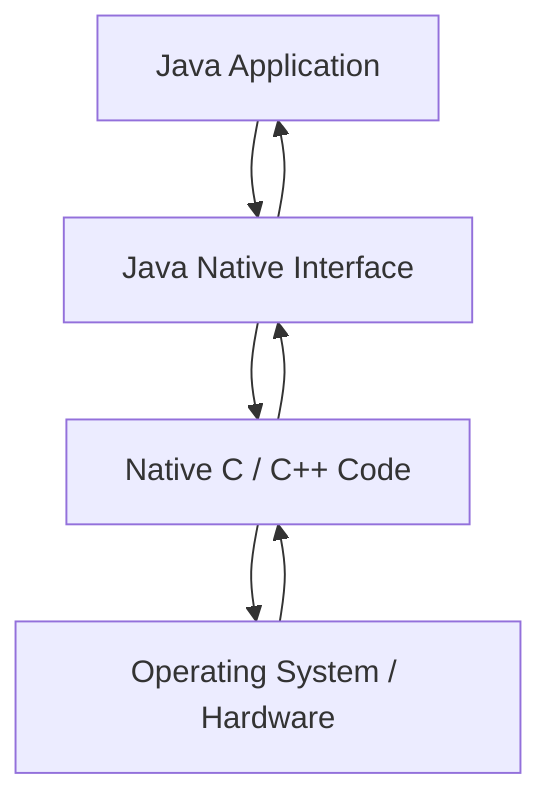
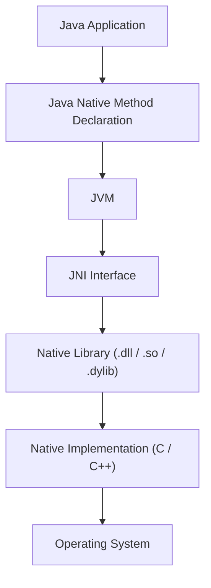
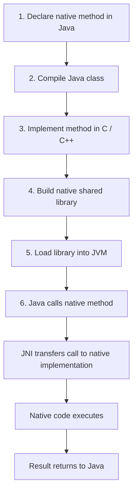
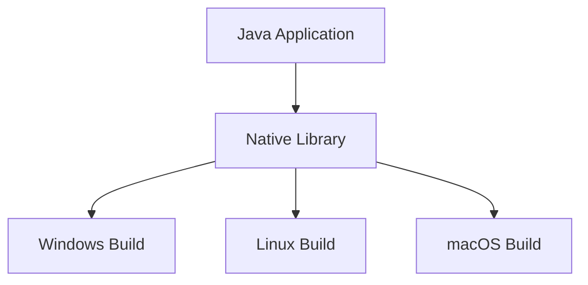
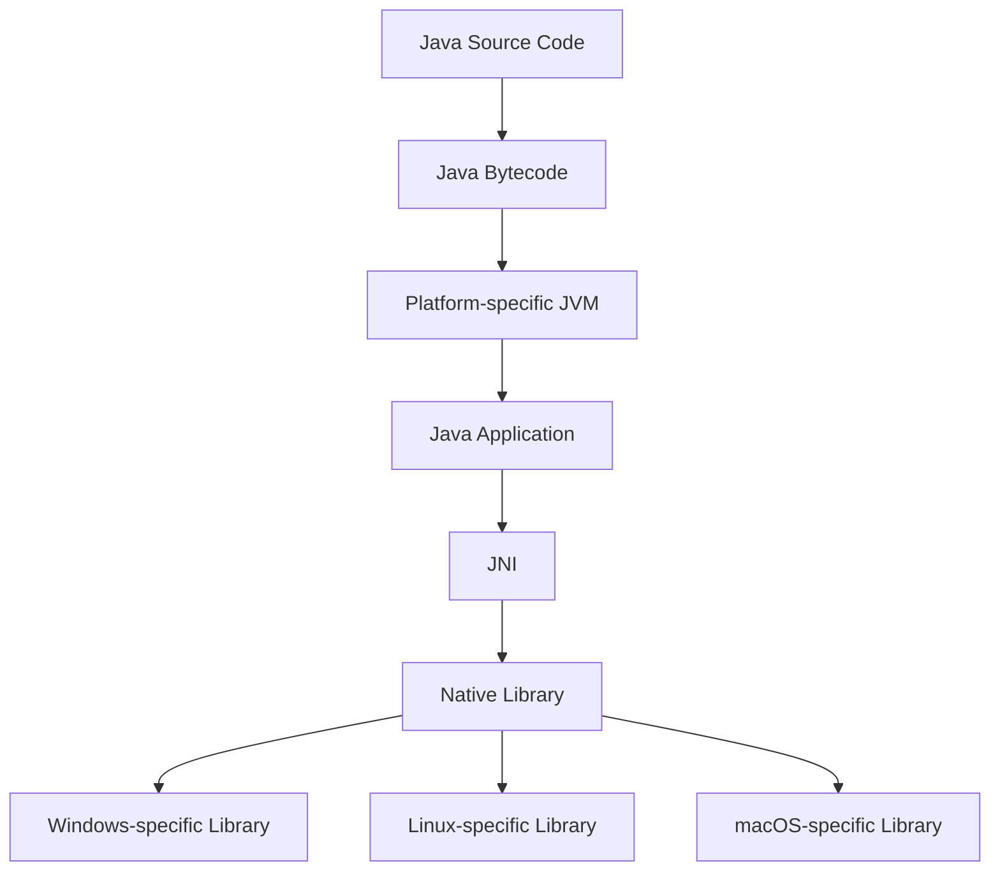

# JNI and Native Libraries in Java

## 1. What is JNI?

JNI stands for **Java Native Interface**.

It is a programming interface that allows Java code running inside a JVM to interact with native code written in languages such as C and C++.

Normally, Java code runs through the JVM.

However, sometimes an application needs to use functionality implemented outside Java.

Examples:

- Operating-system-specific functionality.
- Existing C/C++ libraries.
- Hardware-level integrations.
- Native performance-sensitive operations.
- Platform-specific APIs.

JNI provides a bridge between Java and native code.

### Simple definition

JNI allows Java applications to call native methods implemented in languages such as C and C++.

---

## 2. Why do we need JNI?

Imagine an organization already has a C++ library that performs image processing.

Instead of rewriting the complete library in Java, the organization may want its Java application to reuse the existing native implementation.

JNI makes this possible.



JNI acts as the communication bridge between Java and native code.

---

## 3. Java Code vs Native Code

### Normal Java method

```java
class Calculator {

    int add(int a, int b) {
        return a + b;
    }
}
```

The method is implemented in Java and compiled into Java bytecode.

### Native Java method

```java
class Calculator {

    public native int add(int a, int b);
}
```

Notice the `native` keyword.

It tells the JVM that the method implementation is provided outside the Java class's ordinary bytecode.

The method declaration does not contain a Java implementation.

---

## 4. JNI Architecture



The file extensions commonly used for native libraries are:

| Operating System | Native Library Extension |
|---|---|
| Windows | `.dll` |
| Linux | `.so` |
| macOS | `.dylib` |

These libraries are platform-specific.

A native library built for Windows generally cannot be loaded directly as a Linux native library.

---

## 5. How does JNI work?

The general process is:

1. Declare a native method in Java.
2. Compile the Java class.
3. Implement the native method in C or C++.
4. Build the native implementation as a shared library.
5. Load the library into the JVM.
6. Call the native method from Java.

### Complete flow



---

## 6. Practical JNI Example

Let's understand a simplified JNI example.

### Step 1: Create Java class

Create `NativeExample.java`.

```java
public class NativeExample {

    static {
        System.loadLibrary("nativecalc");
    }

    public native int add(int a, int b);

    public static void main(String[] args) {

        NativeExample example = new NativeExample();

        int result = example.add(10, 20);

        System.out.println(result);
    }
}
```

Important parts:

```java
public native int add(int a, int b);
```

Declares a native method.

```java
System.loadLibrary("nativecalc");
```

Loads the native library named `nativecalc`.

The platform-specific library filename is resolved by the JVM.

For example:

- Windows: `nativecalc.dll`
- Linux: `libnativecalc.so`
- macOS: `libnativecalc.dylib`

### Step 2: Compile Java class and generate JNI header

```bash
javac -h . NativeExample.java
```

This generates:

- `NativeExample.class`
- `NativeExample.h`

The header contains the JNI declaration that can be used by the native implementation.

### Step 3: Implement native method in C

Create `NativeExample.c`.

```c
#include <jni.h>
#include "NativeExample.h"

JNIEXPORT jint JNICALL
Java_NativeExample_add(
    JNIEnv *env,
    jobject thisObject,
    jint a,
    jint b
) {
    return a + b;
}
```

A few important terms:

| Term | Meaning |
|---|---|
| `JNIEnv` | Provides access to JNI functions |
| `jobject` | Represents the Java object for an instance native method |
| `jint` | JNI representation of a Java `int` |
| `JNIEXPORT` | Platform-specific export declaration |
| `JNICALL` | Platform-specific calling convention macro |

The generated header should be treated as the source of truth for the native function declaration.

### Step 4: Build native library

The exact compiler command depends on the operating system, C/C++ compiler, and JDK installation.

For example, on Linux, a simplified command is:

```bash
gcc -shared -fPIC \
  -I"$JAVA_HOME/include" \
  -I"$JAVA_HOME/include/linux" \
  -o libnativecalc.so NativeExample.c
```

On Windows, a compatible compiler and Windows-specific JNI include directory are required.

### Step 5: Run Java application

Make sure the native library is available through the JVM's native library search path.

Then execute:

```bash
java -Djava.library.path=. NativeExample
```

Expected output:

```text
30
```

This is a learning example. Native library compilation and loading require a compatible operating system, architecture, compiler, and JDK.

---

## 7. System.load() vs System.loadLibrary()

Java provides two commonly used methods for loading native libraries.

### System.load()

Accepts an absolute path to the native library.

```java
System.load("C:\\native\\nativecalc.dll");
```

### System.loadLibrary()

Accepts a logical library name without the platform-specific prefix or extension.

```java
System.loadLibrary("nativecalc");
```

The JVM resolves the platform-specific library filename.

| System.load() | System.loadLibrary() |
|---|---|
| Uses an absolute file path | Uses a logical library name |
| Requires a full path | Uses native library search locations |
| Platform-specific path | Platform-specific filename resolution |

---

## 8. JNI vs Java Native Method

These terms are related but different.

| JNI | Native Method |
|---|---|
| Interface between Java and native code | Java method declaration implemented outside Java |
| Provides functions for interoperability | Uses the `native` keyword |
| Helps communicate with native libraries | Invokes native functionality |

Example:

```java
public native void performTask();
```

This is a native method declaration.

JNI provides the interface through which the JVM and native implementation communicate.

---

## 9. Advantages of JNI

1. **Code reuse:** Existing native libraries can be reused.
2. **Platform integration:** Java can access native operating-system capabilities.
3. **Hardware integration:** Native libraries can communicate with hardware through platform APIs.
4. **Performance-sensitive operations:** Native code can be useful for certain specialized workloads.
5. **Interoperability:** Java applications can work with C/C++ libraries.

---

## 10. Disadvantages and Risks of JNI

JNI is powerful, but it introduces additional complexity.

### 10.1 Platform dependency

Native libraries must generally be built for the target operating system and CPU architecture.



The same Java application may need different native library builds for different platforms.

### 10.2 Memory management

Native code can allocate and manage memory outside the ordinary Java object lifecycle.

Incorrect native memory management can cause:

- Memory leaks.
- Invalid memory access.
- Native crashes.

### 10.3 Debugging complexity

A problem may occur inside Java code, JNI interaction, or the native library.

Debugging can require both Java and native debugging tools.

### 10.4 Safety concerns

Native code does not receive all the same memory-safety protections that ordinary Java code provides.

Incorrect pointer handling can crash the process.

### 10.5 Maintenance overhead

The team may need to maintain multiple native builds and keep them compatible with the Java application.

---

## 11. JNI and Java Platform Independence

One of Java's major strengths is platform independence through bytecode and platform-specific JVM implementations.

However, JNI introduces a platform-dependent component.



The Java bytecode may remain portable, but the native library usually needs a compatible build for the target platform.

### Interview takeaway

Java's platform independence does not automatically make native libraries platform-independent.

---

## 12. JNI vs JNA vs FFM API

These are different approaches to native interoperability.

| Technology | Description |
|---|---|
| JNI | Standard Java Native Interface for Java/native interaction |
| JNA | Third-party library that simplifies calling native libraries |
| FFM API | Foreign Function and Memory API for interoperating with native code |

### FFM API

Modern Java provides the Foreign Function and Memory (FFM) API for native interoperability.

It is designed to make calling native functions and accessing native memory easier without requiring traditional JNI glue code for every interaction.

The FFM API was finalized in JDK 22.

JNI remains relevant, especially for existing native integrations.

---

## 13. Real-World Use Cases

JNI and native interoperability may be used in:

- Image and video processing libraries.
- Audio processing.
- Hardware drivers and device integrations.
- Existing C/C++ libraries.
- Operating-system-specific functionality.
- Scientific and numerical computing.
- Specialized native performance libraries.

Not every Java application needs JNI.

Most ordinary Java backend applications can be developed without writing native code.

---

## 14. Interview Questions

### Q1. What is JNI?

Java Native Interface, which allows Java applications to interact with native code.

### Q2. Why do we need JNI?

To reuse native libraries or access functionality implemented outside Java.

### Q3. What does the `native` keyword mean?

It declares that the method implementation is provided outside ordinary Java code.

### Q4. What is `System.loadLibrary()`?

It loads a native library by its logical name.

### Q5. What is the difference between `System.load()` and `System.loadLibrary()`?

`System.load()` uses an absolute path, while `System.loadLibrary()` uses a logical library name.

### Q6. Is JNI platform-independent?

JNI is a standard interface, but native library binaries are generally platform and architecture dependent.

### Q7. What are the disadvantages of JNI?

Platform dependency, memory-safety risks, debugging complexity, and maintenance overhead.

### Q8. What is the difference between JNI and JNA?

JNI is the standard native interface, while JNA is a third-party library that simplifies access to native libraries.

### Q9. What is the FFM API?

A modern Java API for accessing foreign functions and memory.

---

## 15. Practice Questions

1. Why would a Java application need JNI?
2. What does the `native` keyword do?
3. Why does JNI need a native library?
4. What is the difference between `.dll`, `.so`, and `.dylib`?
5. Why can a Windows native library not normally be used on Linux?
6. What is the difference between `System.load()` and `System.loadLibrary()`?
7. How can native code introduce memory-safety problems?
8. What is the difference between JNI, JNA, and FFM?
9. Does every Java backend application need JNI?

---

## 16. Quick Revision

| Concept | Meaning |
|---|---|
| JNI | Java Native Interface |
| Native Method | Java method implemented outside ordinary Java code |
| `native` | Keyword used to declare a native method |
| `System.load()` | Loads a library using an absolute path |
| `System.loadLibrary()` | Loads a library using its logical name |
| `.dll` | Common Windows native library format |
| `.so` | Common Linux shared library format |
| `.dylib` | Common macOS dynamic library format |
| JNA | Third-party native access library |
| FFM | Foreign Function and Memory API |

## 17. Check Your Understanding

- [ ] Explain JNI in simple terms.
- [ ] Explain why Java applications use native libraries.
- [ ] Explain the JNI architecture.
- [ ] Understand the `native` keyword.
- [ ] Understand `System.load()` and `System.loadLibrary()`.
- [ ] Explain platform dependency of native libraries.
- [ ] Explain JNI's advantages and disadvantages.
- [ ] Distinguish JNI, JNA, and FFM.

## Related Topics

- [JVM](../03-Java-Platform/jvm.md)
- [Class Loader](class-loader.md)
- [Runtime Data Areas](runtime-data-areas.md)
- [Execution Engine](execution-engine.md)
- [Java Execution Flow](../04-Java-Execution/java-execution-flow.md)