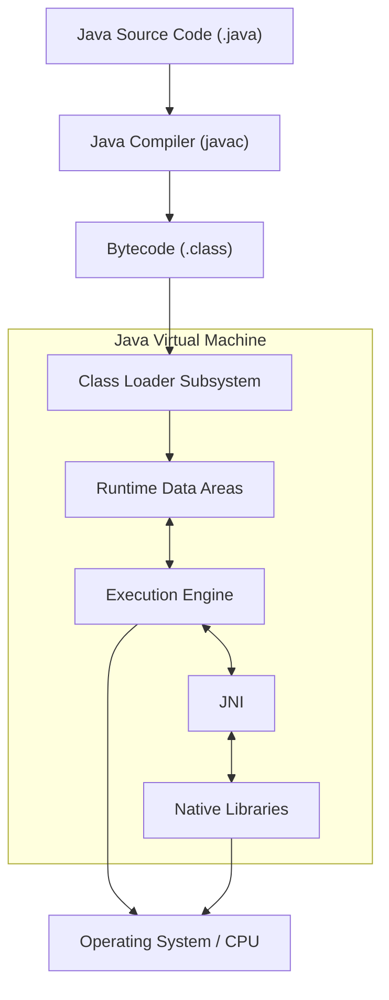
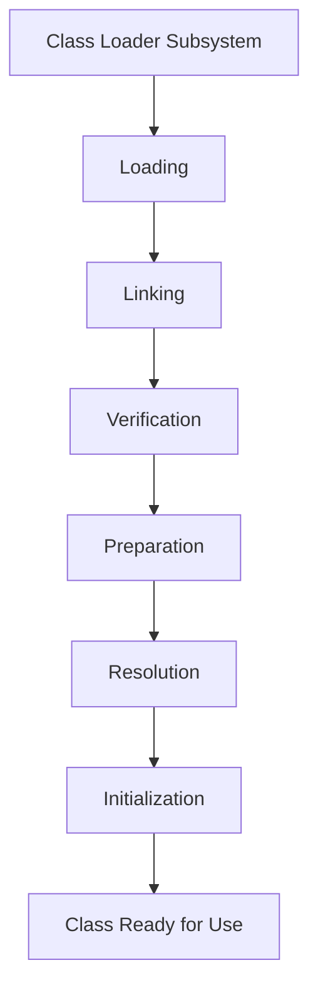
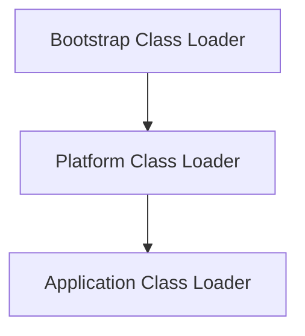
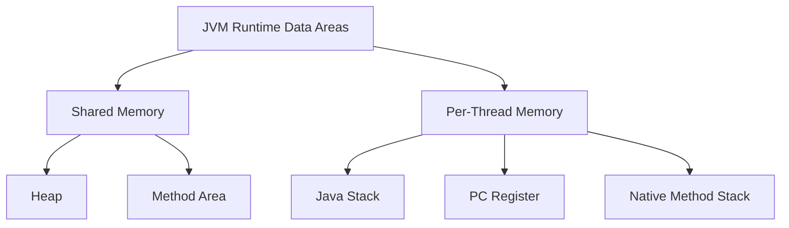
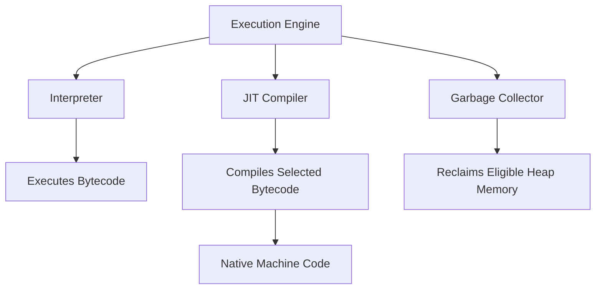
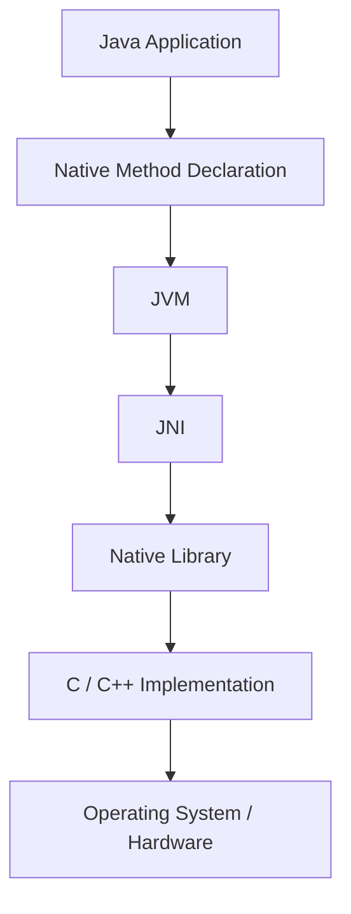
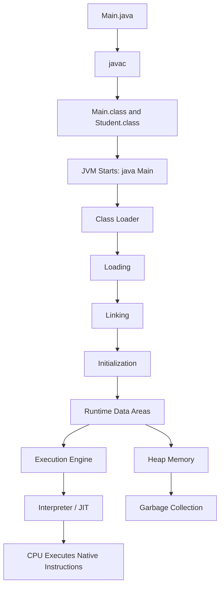
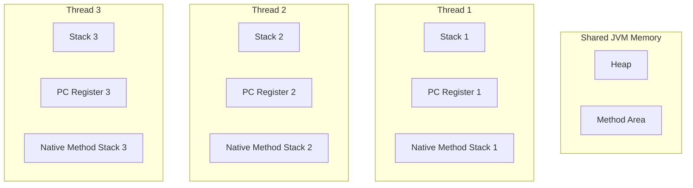
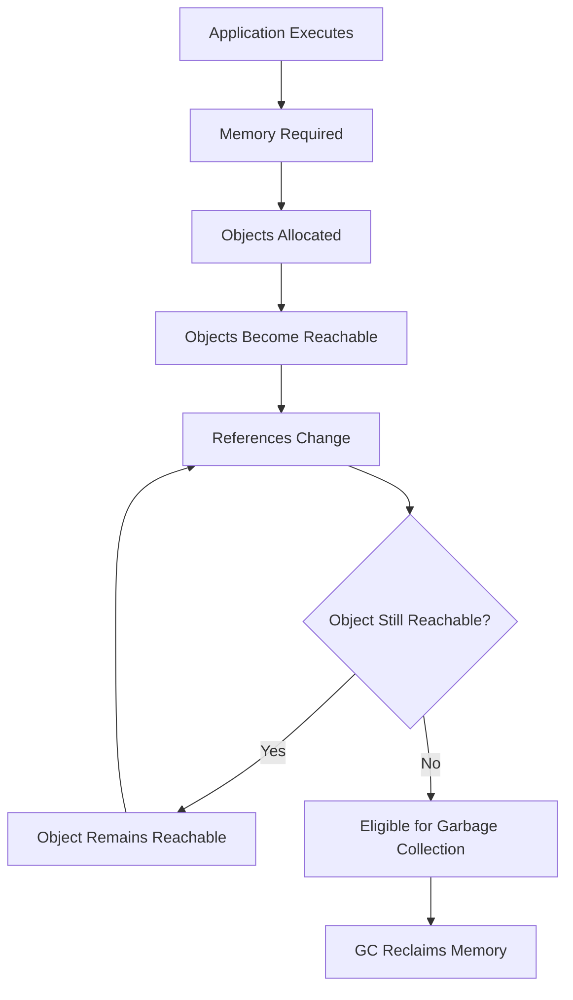

# JVM Architecture

## 1. What is JVM Architecture?

The **Java Virtual Machine (JVM)** is an abstract machine that provides the runtime environment for executing Java bytecode.

JVM Architecture describes how the JVM:

- Loads Java classes.
- Verifies and prepares bytecode.
- Allocates and manages runtime memory.
- Executes bytecode.
- Optimizes frequently executed code.
- Reclaims memory using Garbage Collection.
- Interacts with native libraries.

Understanding JVM Architecture helps us understand what happens internally when we execute a Java application.

---

## 2. Complete JVM Architecture

Let's first understand the complete architecture before studying individual components.



The JVM architecture can be understood through four major components:

1. Class Loader Subsystem.
2. Runtime Data Areas.
3. Execution Engine.
4. Java Native Interface (JNI) and Native Libraries.

Garbage Collection is an important part of JVM memory management and is associated with the runtime memory and execution environment.

---

## 3. Component 1: Class Loader Subsystem

The Class Loader Subsystem loads Java class definitions into JVM memory.

When we execute:

```bash
java Main
```

The JVM needs to load the `Main` class and other classes required by the application.

The Class Loader Subsystem handles this process.

### Class Loader phases



### What happens in each phase?

| Phase | Responsibility |
|---|---|
| Loading | Finds and loads class bytecode |
| Verification | Checks bytecode validity |
| Preparation | Allocates static fields and assigns default values |
| Resolution | Resolves symbolic references |
| Initialization | Executes static initialization code |

Linking consists of verification, preparation, and resolution.

### Types of Class Loaders



- **Bootstrap:** Loads fundamental Java runtime classes.
- **Platform:** Loads platform classes and libraries.
- **Application:** Loads application classes from the classpath or module path.

Java commonly follows the Parent Delegation Model, where a class loader delegates to its parent before trying to load a class itself.

Read more: [Class Loader](class-loader.md)

---

## 4. Component 2: Runtime Data Areas

After classes are loaded, the JVM requires memory to execute the application.

Runtime Data Areas are the memory regions used by the JVM during execution.

They are divided into shared and per-thread areas.

### Runtime Data Areas Architecture



### A. Heap

The Heap stores objects and arrays.

Example:

```java
Student student = new Student();
```

Conceptually:

- The `student` reference is a local variable in the method's stack frame.
- The Student object is allocated in the heap.

### B. Method Area

The Method Area is a JVM specification concept that describes storage for class-level runtime structures, such as:

- Class metadata.
- Method information.
- Field information.
- Runtime constant pools.

In HotSpot JVM, class metadata is commonly stored in Metaspace.

### C. Java Stack

Each thread has its own Java Stack.

It stores stack frames associated with method invocations.

Example:

```java
public static void main(String[] args) {
    calculate();
}

static void calculate() {
    int result = 10 + 20;
}
```

When `calculate()` is called, a new stack frame is created. When it returns, that frame is removed.

### D. PC Register

Each thread has its own Program Counter Register.

It tracks the current JVM instruction being executed by that thread.

### E. Native Method Stack

It supports native method execution.

Native methods are implemented outside ordinary Java code, commonly in C or C++.

### Shared vs Per-Thread Memory

| Runtime Area | Shared / Per-Thread | Purpose |
|---|---|---|
| Heap | Shared | Objects and arrays |
| Method Area | Shared | Class-level runtime structures |
| Java Stack | Per-thread | Method execution frames |
| PC Register | Per-thread | Current JVM instruction |
| Native Method Stack | Per-thread | Native method execution support |

Read more: [Runtime Data Areas](runtime-data-areas.md)

---

## 5. Component 3: Execution Engine

The Execution Engine is responsible for executing the bytecode loaded into the JVM.

The CPU does not directly execute Java bytecode. The JVM uses execution mechanisms to run it on the underlying machine.

### Execution Engine Architecture



### A. Interpreter

The Interpreter reads and executes bytecode instructions at runtime.

It allows code to start executing without compiling every method into native code first.

### B. JIT Compiler

JIT stands for Just-In-Time Compiler.

It compiles selected frequently executed bytecode into native machine code at runtime.

This can improve application performance.

### C. Garbage Collector

Garbage Collection automatically reclaims heap memory occupied by objects that are no longer reachable.

Example:

```java
Student student = new Student();

student = null;
```

If no other reachable reference points to the object, it may become eligible for garbage collection.

Important: GC does not guarantee immediate object collection.

### Interpreter vs JIT

| Interpreter | JIT Compiler |
|---|---|
| Executes bytecode | Compiles selected bytecode into native code |
| Supports quick initial execution | Can improve frequently executed code |
| Does not require every method to be compiled first | Uses runtime information to optimize selected code |

Read more: [Execution Engine](execution-engine.md)

---

## 6. Component 4: JNI and Native Libraries

JNI stands for Java Native Interface.

It allows Java code to interact with native code written in languages such as C and C++.

### Why is JNI needed?

Imagine an organization already has a C++ library for image processing.

Instead of rewriting the entire library in Java, the application may reuse that native implementation through JNI.

### JNI Architecture



Java provides the `native` keyword for declaring native methods.

Example:

```java
public class NativeExample {

    public native void performTask();
}
```

Native library formats commonly include:

| Operating System | Library Format |
|---|---|
| Windows | `.dll` |
| Linux | `.so` |
| macOS | `.dylib` |

Native libraries are generally platform and architecture dependent.

Read more: [JNI and Native Libraries](jni-and-native-libraries.md)

---

## 7. Complete JVM Execution: A Practical Example

Let's connect all the components using a simple Java program.

### Step 1: Java Source Code

Create `Main.java`.

```java
class Student {

    String name;

    Student(String name) {
        this.name = name;
    }

    void study() {
        int hours = 2;

        System.out.println(
            name + " studies for " + hours + " hours"
        );
    }
}

public class Main {

    public static void main(String[] args) {

        Student student = new Student("Alex");

        student.study();
    }
}
```

### Step 2: Compilation

Run:

```bash
javac Main.java
```

The Java compiler generates:

```text
Main.class
Student.class
```

These files contain Java bytecode.

### Step 3: JVM Starts

Run:

```bash
java Main
```

The JVM starts and prepares to execute the application.

### Step 4: Class Loader

The Class Loader loads the required classes.

For example:

- Main.
- Student.
- Other required runtime classes.

The classes go through the relevant linking and initialization processes.

### Step 5: Runtime Data Areas

The JVM uses runtime memory to execute the program.

Conceptually:

- The `main()` method has a stack frame.
- The local variable `student` is maintained in that frame.
- The Student object is allocated in the heap.
- Class metadata is maintained in the Method Area concept.

### Step 6: Execution Engine

The Execution Engine executes the bytecode.

It may use interpretation and JIT compilation depending on runtime behavior.

### Step 7: Garbage Collection

When objects are no longer reachable, their memory may be reclaimed by the Garbage Collector.

### Complete Execution Flow



---

## 8. JVM Architecture vs Java Execution Flow

These two concepts are related but not identical.

| JVM Architecture | Java Execution Flow |
|---|---|
| Describes JVM components | Describes how a program moves through execution |
| Focuses on internal structure | Focuses on execution sequence |
| Includes Class Loader, Runtime Data Areas, Execution Engine, JNI | Includes compilation, class loading, initialization, execution |
| Explains what components do | Explains when and how they participate |

A useful way to remember:

- Architecture = What components exist?
- Execution Flow = How does a program pass through those components?

---

## 9. JVM Architecture and Multithreading

The JVM supports multiple threads executing concurrently.

Each thread has its own:

- Java Stack.
- PC Register.
- Native Method Stack.

Threads share:

- Heap.
- Method Area.

### Visualization



This explains an important multithreading concept:

Two threads can have separate local execution data while accessing shared objects in the heap.

That is why synchronization and thread safety matter in Java applications.

---

## 10. JVM Architecture and Memory Management

Memory management is one of the JVM's important responsibilities.

The JVM manages:

1. Allocation of runtime memory.
2. Creation of stack frames.
3. Object allocation.
4. Garbage collection.
5. Class metadata storage.

### Simplified memory lifecycle



---

## 11. Common JVM Architecture Misconceptions

### 1. JVM and JDK are the same.

No.

- JVM executes bytecode.
- JRE is the runtime environment concept.
- JDK provides development tools and runtime capabilities.

### 2. JVM directly executes Java source code.

No.

Java source code is normally compiled into bytecode before JVM execution.

### 3. Heap is private to each thread.

No. The heap is shared across threads.

### 4. Java Stack is shared by all threads.

No. Each thread has its own Java Stack.

### 5. Garbage Collection immediately destroys unused objects.

No. It reclaims memory when the JVM performs garbage collection.

### 6. JIT compiles every method.

No. JIT generally compiles selected code based on runtime behavior and implementation policies.

### 7. Java is completely independent of the operating system.

Java bytecode is portable, but the JVM implementation and native libraries are platform dependent.

---

## 12. Important Interview Questions

### Q1. What are the major components of JVM Architecture?

- Class Loader Subsystem.
- Runtime Data Areas.
- Execution Engine.
- JNI and Native Libraries.

### Q2. What is the role of the Class Loader?

It loads Java class definitions into the JVM.

### Q3. What are Runtime Data Areas?

Memory regions used by the JVM during application execution.

### Q4. Which memory areas are shared among threads?

Heap and Method Area.

### Q5. Which memory areas are per-thread?

Java Stack, PC Register, and Native Method Stack.

### Q6. What is the role of the Execution Engine?

It executes loaded Java bytecode using mechanisms such as interpretation and JIT compilation.

### Q7. What is the role of Garbage Collection?

It reclaims heap memory occupied by objects that are no longer reachable.

### Q8. What is JNI?

It enables Java applications to interact with native code.

### Q9. What is the difference between JVM Architecture and Java Execution Flow?

Architecture describes JVM components; execution flow describes how an application progresses through them.

### Q10. Why is JVM platform dependent?

Because each operating system and supported architecture requires a compatible JVM implementation to execute bytecode.

---

## 13. Practical Understanding Exercises

### Exercise 1: Class Loading

Create two Java classes:

```java
class Employee {
    String name;
}

public class Main {
    public static void main(String[] args) {
        Employee employee = new Employee();
    }
}
```

Questions:

1. Which classes need to be loaded?
2. What is the role of the Class Loader?
3. Does loading Employee create an Employee object?

### Exercise 2: Runtime Memory

Consider:

```java
public class Main {

    public static void main(String[] args) {

        int a = 10;

        Student student = new Student();

        student.name = "Alex";
    }
}

class Student {
    String name;
}
```

Questions:

1. Where is local variable `a` maintained?
2. Where is the local reference `student` maintained?
3. Where is the Student object allocated?
4. Where does the instance field `name` belong?

### Exercise 3: Stack Frames

```java
public class Main {

    static void first() {
        second();
    }

    static void second() {
        System.out.println("Hello");
    }

    public static void main(String[] args) {
        first();
    }
}
```

Questions:

1. How many method calls are active when `second()` is executing?
2. Which stack frame is at the top?
3. What happens when `second()` returns?

### Exercise 4: Execution Engine

Questions:

1. What does the Interpreter do?
2. What does the JIT Compiler do?
3. Why does JVM warm-up matter?
4. Does JIT compile every method?

### Exercise 5: Native Integration

Questions:

1. What does the `native` keyword indicate?
2. Why might a Java application use JNI?
3. Why might a native library require a different build for Windows and Linux?

---

## 14. Quick Revision

| JVM Component | Main Responsibility |
|---|---|
| Class Loader | Loads classes |
| Loading | Loads bytecode and creates runtime class representation |
| Linking | Verifies, prepares, and resolves |
| Initialization | Executes static initialization code |
| Heap | Stores objects and arrays |
| Method Area | Holds class-level runtime structures |
| Java Stack | Stores method stack frames |
| PC Register | Tracks current JVM instruction |
| Native Method Stack | Supports native method execution |
| Interpreter | Executes bytecode |
| JIT Compiler | Compiles selected bytecode into native code |
| Garbage Collector | Reclaims memory of eligible objects |
| JNI | Connects Java and native code |

---

## 15. Check Your Understanding

Before moving to the next Java topic, make sure you can:

- [ ] Draw JVM Architecture without looking at notes.
- [ ] Explain the role of the Class Loader.
- [ ] Explain Loading, Linking, and Initialization.
- [ ] Draw Runtime Data Areas.
- [ ] Distinguish shared and per-thread memory.
- [ ] Explain Stack vs Heap.
- [ ] Explain Interpreter vs JIT.
- [ ] Explain Garbage Collection.
- [ ] Explain JNI and native libraries.
- [ ] Trace one Java program through the JVM.

---

## 16. Related Topics

### Java Fundamentals

- [What is Java?](../01-Java-Basics/what-is-java.md)
- [Features of Java](../01-Java-Basics/features-of-java.md)

### Java Platform

- [JVM](../03-Java-Platform/jvm.md)
- [JRE](../03-Java-Platform/jre.md)
- [JDK](../03-Java-Platform/jdk.md)
- [JVM vs JRE vs JDK](../03-Java-Platform/jvm-vs-jre-vs-jdk.md)

### Java Execution

- [Compiler vs Interpreter](../04-Java-Execution/compiler-vs-interpreter.md)
- [Java Execution Flow](../04-Java-Execution/java-execution-flow.md)
- [JIT Compiler](../04-Java-Execution/jit-compiler.md)

### JVM Architecture Deep Dive

- [Class Loader](class-loader.md)
- [Runtime Data Areas](runtime-data-areas.md)
- [Execution Engine](execution-engine.md)
- [JNI and Native Libraries](jni-and-native-libraries.md)