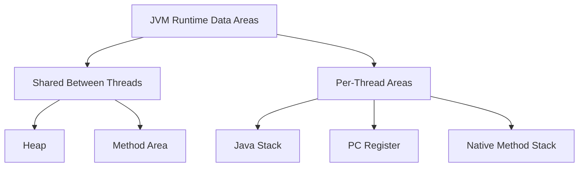
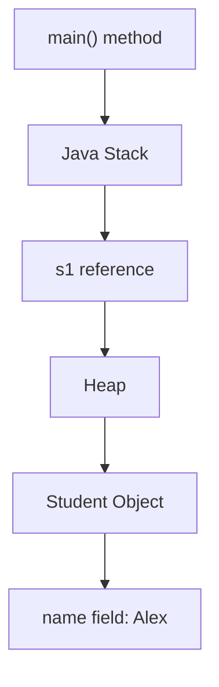
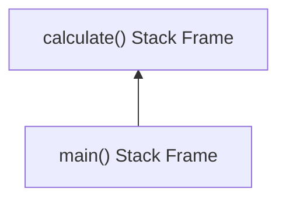
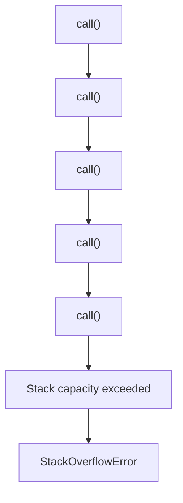
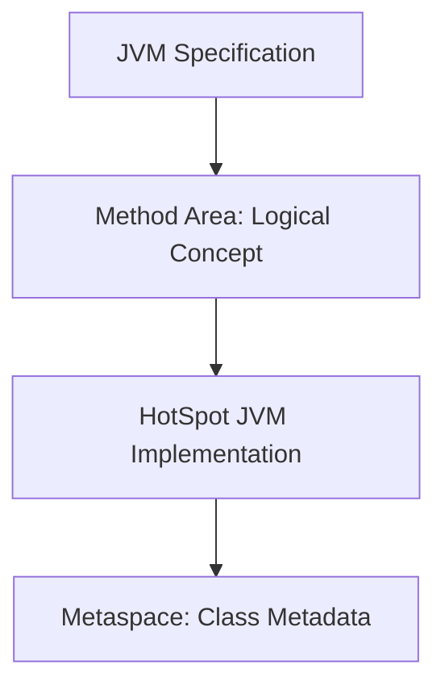
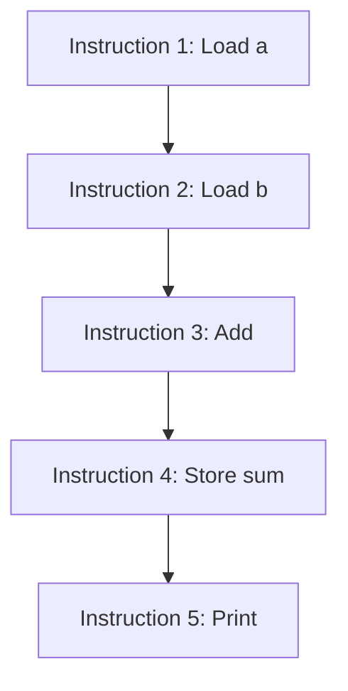
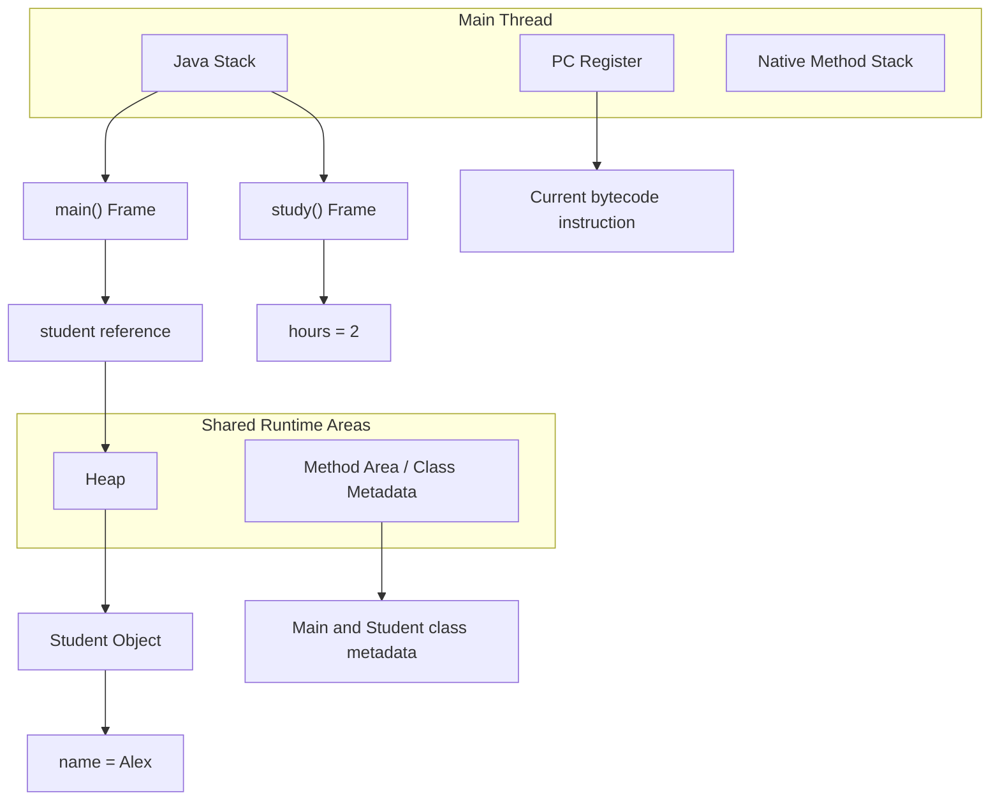
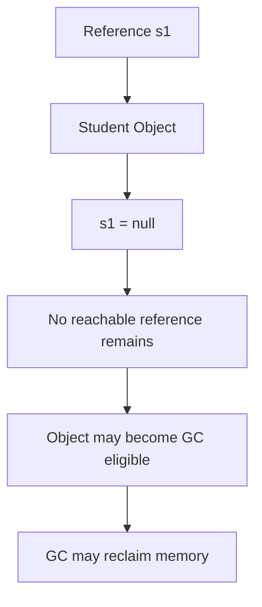

# JVM Runtime Data Areas

## 1. What are Runtime Data Areas?

Runtime Data Areas are the memory regions that the JVM uses while executing a Java program.

When a Java application runs, the JVM needs memory to store:

- Objects.
- Local variables.
- Method calls.
- Class-level information.
- Intermediate execution data.
- Information required to execute bytecode.

The JVM organizes this memory into different runtime areas.

### Simple definition

Runtime Data Areas are the memory areas used by the JVM to execute a Java application.

---

## 2. JVM Runtime Memory Architecture

The JVM specification defines several runtime data areas.

Some are shared across threads, while others are created separately for each thread.



### Shared vs Thread-specific memory

| Shared Areas | Per-Thread Areas |
|---|---|
| Heap | Java Stack |
| Method Area | PC Register |
| | Native Method Stack |

This distinction is important when understanding multithreading.

---

## 3. Heap Memory

The **Heap** is the runtime memory area where Java objects and arrays are allocated.

It is shared among application threads.

Example:

```java
class Student {
    String name;
}

public class Main {
    public static void main(String[] args) {

        Student s1 = new Student();

        s1.name = "Alex";
    }
}
```

Conceptually:



Here:

- `s1` is a local reference variable.
- The Student object is allocated on the heap.
- The object's instance field belongs to that object.

### Important heap characteristics

- Shared across threads.
- Stores objects and arrays.
- Managed by the garbage collector.
- Objects can remain alive beyond the method that created them if references remain reachable.

### Example with multiple objects

```java
Student s1 = new Student();
Student s2 = new Student();
```

Conceptual heap:

```text
Heap
+-----------------------+
| Student Object 1      |
| name = null           |
+-----------------------+
| Student Object 2      |
| name = null           |
+-----------------------+
```

The references `s1` and `s2` are local variables if declared inside a method. The objects are allocated in the heap.

---

## 4. Java Stack

Each Java thread has its own JVM stack.

The Java stack stores method execution information through **Stack Frames**.

Whenever a method is called:

1. A new stack frame is created.
2. Local variables and intermediate calculations are maintained in that frame.
3. The method executes.
4. The frame is removed when the method completes.

Example:

```java
public class Main {

    static void calculate() {
        int a = 10;
        int b = 20;

        int sum = a + b;
    }

    public static void main(String[] args) {
        calculate();
    }
}
```

### Stack frame visualization



While `calculate()` is executing, its frame is on top of the `main()` frame.

When `calculate()` finishes, its frame is removed.

### Stack Frame Contents

A stack frame conceptually contains:

- Local variables.
- Operand stack.
- Reference to the runtime constant pool for the current class.
- Information needed for method completion.

The exact implementation details are JVM-specific.

### Stack vs Heap

| Java Stack | Heap |
|---|---|
| Per-thread | Shared |
| Stores stack frames | Stores objects and arrays |
| Method execution data | Object data |
| Frames are pushed and popped | Objects are reclaimed by GC when eligible |
| Each thread has its own stack | Shared among threads |

### Stack Overflow

Consider:

```java
public class Main {

    static void call() {
        call();
    }

    public static void main(String[] args) {
        call();
    }
}
```

This method calls itself indefinitely.

Each call requires another stack frame.

Eventually, the stack may run out of space and the JVM throws:

```text
StackOverflowError
```

Visual representation:



---

## 5. Method Area

The Method Area is a logical runtime memory area defined by the JVM specification.

It stores class-level structures and metadata, such as:

- Class and interface information.
- Runtime constant pool.
- Method information.
- Field information.
- Method and constructor metadata.

It is shared among threads.

### Example

```java
class Student {

    static int count = 0;

    void study() {
        System.out.println("Studying");
    }
}
```

The JVM needs class metadata describing `Student`, its fields, and its methods.

The Method Area is the specification-level concept used to describe this kind of information.

### Method Area vs Metaspace

This is an important interview distinction.

- Method Area is defined by the JVM specification.
- Metaspace is the memory area used by HotSpot JVM to store class metadata in modern Java versions.
- Metaspace uses native memory rather than being part of the ordinary Java heap.

Do not assume that Method Area and Metaspace are identical terms for every JVM implementation.



---

## 6. PC Register

PC stands for **Program Counter**.

Each JVM thread has its own PC Register.

It keeps track of the current JVM instruction being executed by that thread.

Example:

```java
public class Main {

    public static void main(String[] args) {
        int a = 10;
        int b = 20;
        int sum = a + b;
        System.out.println(sum);
    }
}
```

Conceptually, the PC Register helps the JVM track which bytecode instruction the current thread should execute next.



The PC Register is per-thread because each thread can be executing a different instruction at the same time.

For a thread executing a non-native method, it identifies the current JVM instruction. Its value is undefined while executing a native method.

---

## 7. Native Method Stack

The Native Method Stack supports execution of native methods.

A native method is a method implemented outside Java, often in languages such as C or C++.

Example:

```java
public class NativeExample {

    public native void performTask();
}
```

The `native` keyword indicates that the method implementation is provided outside ordinary Java code.

The native method stack is associated with native method execution. Its exact implementation and organization depend on the JVM.

---

## 8. Complete Runtime Data Areas Example

Consider:

```java
class Student {

    String name;

    Student(String name) {
        this.name = name;
    }

    void study() {
        int hours = 2;
        System.out.println(name + " studies for " + hours + " hours");
    }
}

public class Main {

    public static void main(String[] args) {

        Student student = new Student("Alex");

        student.study();
    }
}
```

### Conceptual memory visualization



This is a conceptual diagram. Actual object layout, references, stack representation, and memory placement depend on the JVM implementation and optimizations.

---

## 9. Garbage Collection and Heap Memory

Garbage Collection (GC) is the JVM's automatic memory-management mechanism.

It identifies objects that are no longer reachable from GC roots and can reclaim their memory.

Example:

```java
Student s1 = new Student("Alex");

s1 = null;
```

If no other reachable reference points to the object, it may become eligible for garbage collection.



Important:

- Setting a reference to `null` does not immediately destroy the object.
- Being eligible for GC does not guarantee immediate collection.
- The JVM decides when to perform garbage collection.

---

## 10. Stack vs Heap: Common Misconceptions

### Misconception 1: Primitive values are always stored on the stack.

Not necessarily.

A local primitive variable is typically represented in its method's stack frame, but a primitive instance field belongs to its object, and a static field belongs to class-level runtime storage.

### Misconception 2: All objects are always physically allocated on the heap.

The JVM specification describes heap allocation for objects and arrays, but JVM implementations can optimize physical allocation. For example, escape analysis may allow an object allocation to be eliminated or optimized.

### Misconception 3: Stack memory is shared by all threads.

No. Each thread has its own JVM stack.

### Misconception 4: Method Area and Metaspace are exactly the same.

No. Method Area is a JVM specification concept; Metaspace is a HotSpot implementation detail.

---

## 11. Interview Questions

### Q1. What are JVM Runtime Data Areas?

Memory areas used by the JVM during program execution.

### Q2. Which areas are shared across threads?

Heap and Method Area.

### Q3. Which areas are created per thread?

Java Stack, PC Register, and Native Method Stack.

### Q4. Where are Java objects allocated?

Conceptually, objects and arrays are allocated in the heap.

### Q5. What is a Stack Frame?

A data structure created for a method invocation that holds method execution information.

### Q6. What causes StackOverflowError?

Usually excessive or unbounded method calls that exhaust the thread's stack.

### Q7. What is Metaspace?

A HotSpot JVM memory area used for class metadata.

### Q8. What is the purpose of the PC Register?

It tracks the current JVM instruction for a thread executing a non-native method.

### Q9. What is the difference between StackOverflowError and OutOfMemoryError?

- StackOverflowError: a thread's stack cannot grow enough for additional frames.
- OutOfMemoryError: the JVM cannot allocate required memory in a relevant memory area.

---

## 12. Practice Questions

1. Where is a `Student` object stored?
2. Where is a local variable declared inside `main()` maintained?
3. What happens when one method calls another method?
4. Why does every thread need its own PC Register?
5. What is the difference between Heap and Method Area?
6. What is the difference between Method Area and Metaspace?
7. Why does infinite recursion lead to StackOverflowError?
8. When does an object become eligible for garbage collection?

---

## 13. Quick Revision

| Runtime Area | Scope | Purpose |
|---|---|---|
| Heap | Shared | Objects and arrays |
| Method Area | Shared | Class-level runtime structures |
| Java Stack | Per-thread | Stack frames and method execution |
| PC Register | Per-thread | Current JVM instruction |
| Native Method Stack | Per-thread | Native method execution support |

## 14. Check Your Understanding

- [ ] Explain all five runtime data areas.
- [ ] Distinguish shared and per-thread areas.
- [ ] Explain how method calls create stack frames.
- [ ] Explain StackOverflowError.
- [ ] Explain Heap vs Stack.
- [ ] Explain Method Area vs Metaspace.
- [ ] Explain garbage collection eligibility.

## Related Topics

- [JVM](../03-Java-Platform/jvm.md)
- [Class Loader](class-loader.md)
- [Execution Engine](execution-engine.md)
- [Java Execution Flow](../04-Java-Execution/java-execution-flow.md)
- [JNI and Native Libraries](jni-and-native-libraries.md)