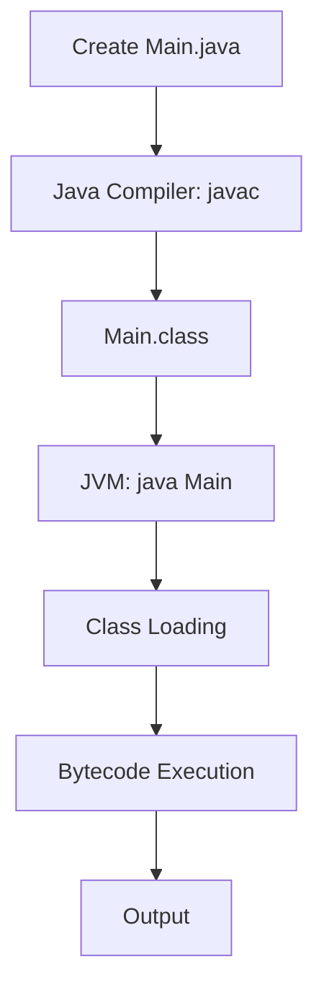
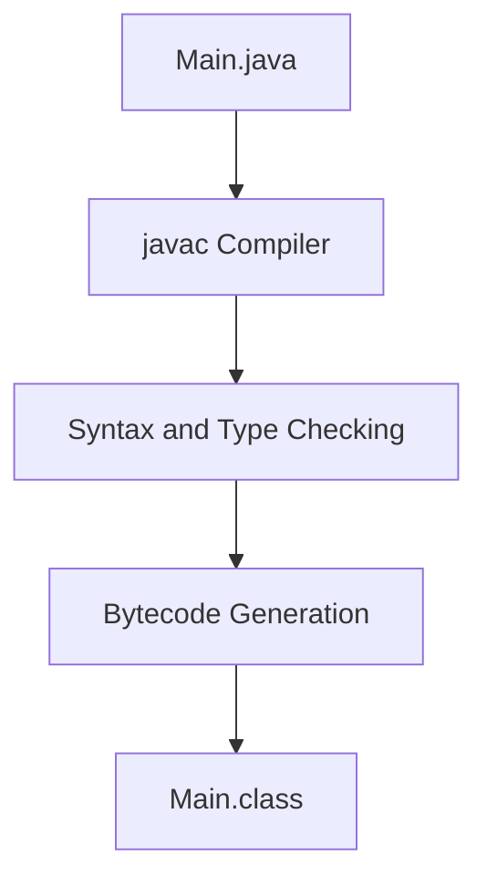
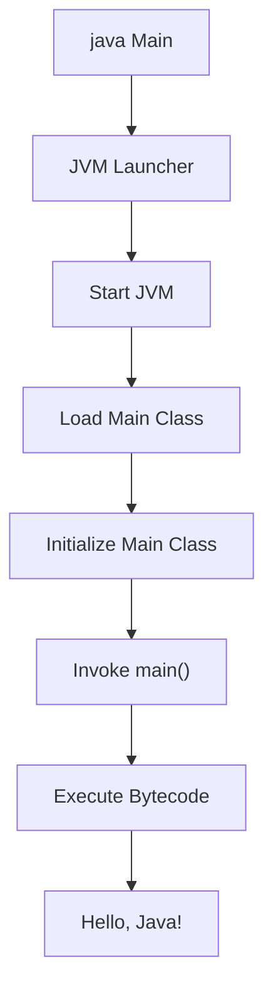
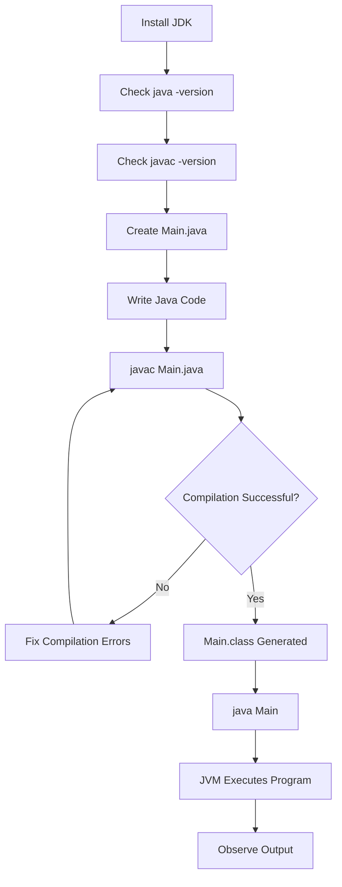

# Compile and Run Java Programs

## 1. Objective

In this practical, we will understand how to compile and execute a Java program using the JDK.

We will learn:

- How to create a Java source file.
- How to compile Java code using `javac`.
- How `.class` files are generated.
- How to execute bytecode using `java`.
- How to check Java and JDK versions.
- How to troubleshoot common errors.

---

## 2. Understand the Java Execution Process

Before running commands, understand the basic flow.



There are two important commands:

| Command | Responsibility |
|---|---|
| `javac` | Compiles Java source code into bytecode |
| `java` | Starts the JVM and launches the application |

---

## 3. Check Java Installation

Open the VS Code terminal or PowerShell.

### Check Java version

```powershell
java -version
```

This displays the installed Java runtime version.

### Check Java compiler version

```powershell
javac -version
```

This displays the installed Java compiler version.

### Check Java installation path

```powershell
where.exe java
where.exe javac
```

These commands help identify which Java executables are being used on Windows.

### Expected result

You should see version information and executable paths.

If `java` works but `javac` does not, check whether a JDK is installed and whether its `bin` directory is configured in PATH.

---

## 4. Create Your First Java Program

Create a folder:

```powershell
mkdir Java-Practical
cd Java-Practical
```

Create a file:

```powershell
New-Item Main.java
```

Add the following code:

```java
public class Main {

    public static void main(String[] args) {

        System.out.println("Hello, Java!");

    }
}
```

### Understand the code

| Code | Meaning |
|---|---|
| `public class Main` | Declares a class named Main |
| `main()` | Entry point recognized by the Java launcher |
| `String[] args` | Command-line arguments |
| `System.out.println()` | Prints output to the console |

---

## 5. Compile the Java Program

Run:

```powershell
javac Main.java
```

If compilation succeeds, Java generates:

```text
Java-Practical/
├── Main.java
└── Main.class
```

### What happened internally?



The `.class` file contains JVM bytecode, not ordinary native machine code for a specific operating system.

### Important

If the source code contains compilation errors, the compiler reports them and normally does not generate the expected class file.

---

## 6. Execute the Java Program

Run:

```powershell
java Main
```

Expected output:

```text
Hello, Java!
```

Notice that we use:

```powershell
java Main
```

Not:

```powershell
java Main.class
```

And not:

```powershell
java Main.java
```

In the normal compile-then-run workflow, we provide the class name without the `.class` extension.

### What happens internally?



The JVM may load additional classes as they are needed. Class loading and initialization can be lazy rather than happening for every class at startup.

---

## 7. Compile and Run in One Command Sequence

You can execute both commands sequentially:

```powershell
javac Main.java
java Main
```

You can also use:

```powershell
javac Main.java; if ($LASTEXITCODE -eq 0) { java Main }
```

The second form runs Java only if compilation succeeds.

---

## 8. Running a Java Program with Command-Line Arguments

Update `Main.java`:

```java
public class Main {

    public static void main(String[] args) {

        System.out.println("Hello, " + args[0]);

    }
}
```

Compile:

```powershell
javac Main.java
```

Run:

```powershell
java Main Bhavesh
```

Output:

```text
Hello, Bhavesh
```

### How does it work?

The launcher passes command-line arguments into:

```java
String[] args
```

For example:

```powershell
java Main Alice Bob
```

Conceptually:

```text
args[0] = "Alice"
args[1] = "Bob"
```

---

## 9. Compile Multiple Java Files

Consider:

```text
Java-Practical/
├── Main.java
└── Student.java
```

`Student.java`:

```java
public class Student {

    public void introduce() {
        System.out.println("I am a student");
    }
}
```

`Main.java`:

```java
public class Main {

    public static void main(String[] args) {

        Student student = new Student();

        student.introduce();
    }
}
```

Compile:

```powershell
javac Main.java Student.java
```

Run:

```powershell
java Main
```

Output:

```text
I am a student
```

The compiler can also compile required source dependencies when they are discoverable through its source path and classpath configuration.

---

## 10. Using Packages

Consider this structure:

```text
Java-Practical/
└── src/
    └── com/
        └── example/
            └── Main.java
```

`Main.java`:

```java
package com.example;

public class Main {

    public static void main(String[] args) {

        System.out.println("Package example");

    }
}
```

From the `Java-Practical` directory, compile:

```powershell
javac -d out src/com/example/Main.java
```

The `-d out` option tells the compiler where to place generated class files.

Result:

```text
Java-Practical/
├── src/
│   └── com/
│       └── example/
│           └── Main.java
└── out/
    └── com/
        └── example/
            └── Main.class
```

Run:

```powershell
java -cp out com.example.Main
```

Output:

```text
Package example
```

### Understand the command

| Part | Meaning |
|---|---|
| `java` | Starts Java launcher |
| `-cp out` | Uses `out` as the classpath |
| `com.example.Main` | Fully qualified class name |

---

## 11. What is Classpath?

Classpath tells Java tools where to find user classes and libraries.

For example:

```powershell
java -cp out com.example.Main
```

Here, `out` is the classpath entry.

You can provide multiple entries using the platform-specific path separator.

On Windows:

```powershell
java -cp "out;lib/*" com.example.Main
```

On Linux and macOS, the separator is `:` instead of `;`.

Classpath is not the same as the Java installation path.

---

## 12. Common Errors

### Error 1: `javac is not recognized`

Possible cause:

- JDK is missing.
- JDK `bin` directory is not configured in PATH.

Check:

```powershell
where.exe javac
javac -version
```

### Error 2: `Could not find or load main class Main`

Possible causes:

- Incorrect current directory.
- Classpath is incorrect.
- Class name is incorrect.
- Package name is missing from the command.

### Error 3: `Main method not found`

The launcher cannot find a valid entry-point method in the class.

A standard entry point is:

```java
public static void main(String[] args)
```

### Error 4: `';' expected`

A Java syntax error.

Check the compiler output and the indicated line.

### Error 5: Class name and filename mismatch

If a class is declared public:

```java
public class Main {
}
```

The source filename must be:

```text
Main.java
```

---

## 13. Java Source-File Mode

Modern Java also supports launching a source file directly:

```powershell
java Main.java
```

In this mode, the Java launcher compiles and runs the source file in one operation.

This is different from the traditional explicit workflow:

```powershell
javac Main.java
java Main
```

For learning compilation and bytecode generation, use the traditional two-step workflow.

---

## 14. Complete Practical Workflow



---

## 15. Practice Tasks

### Task 1: Basic Compilation

1. Create `Hello.java`.
2. Print your name.
3. Compile it using `javac`.
4. Run it using `java`.
5. Observe the generated `.class` file.

### Task 2: Command-Line Arguments

Create a program that accepts:

- Name.
- Age.
- City.

Print all three values.

### Task 3: Multiple Classes

Create:

- `Main.java`
- `Calculator.java`

Implement addition, subtraction, multiplication, and division in Calculator.

### Task 4: Packages

Create a package named `com.practice`.

Compile the program using `-d`.

Execute it using the correct classpath and fully qualified class name.

### Task 5: Compilation Errors

Intentionally introduce:

- Missing semicolon.
- Incorrect class name.
- Incorrect method declaration.

Observe the compiler errors and correct them.

---

## 16. Quick Revision

| Command | Purpose |
|---|---|
| `java -version` | Check Java runtime version |
| `javac -version` | Check compiler version |
| `where.exe java` | Locate Java executable on Windows |
| `where.exe javac` | Locate Java compiler on Windows |
| `javac Main.java` | Compile source code |
| `java Main` | Execute compiled class |
| `javac -d out Main.java` | Specify output directory |
| `java -cp out Main` | Specify classpath |
| `javac -h . Main.java` | Generate JNI header when native declarations exist |

## 17. Check Your Understanding

- [ ] Explain the difference between `java` and `javac`.
- [ ] Compile a Java source file.
- [ ] Identify the generated `.class` file.
- [ ] Execute a Java class.
- [ ] Pass command-line arguments.
- [ ] Compile multiple Java files.
- [ ] Compile and execute a packaged class.
- [ ] Explain classpath.
- [ ] Troubleshoot common compilation and execution errors.

## Related Topics

- [What is Java?](../01-Java-Basics/what-is-java.md)
- [JDK](../03-Java-Platform/jdk.md)
- [JVM](../03-Java-Platform/jvm.md)
- [Java Execution Flow](../04-Java-Execution/java-execution-flow.md)
- [Inspect Bytecode](inspect-bytecode.md)