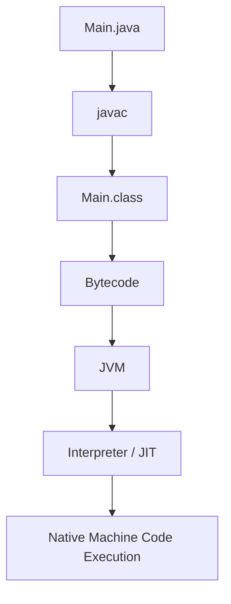
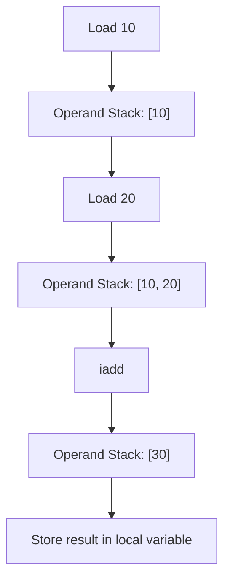
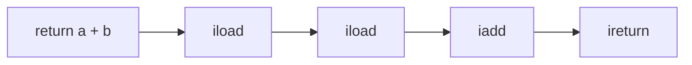
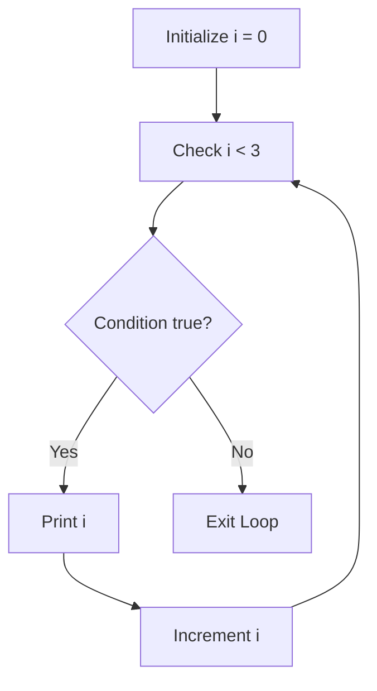

# Inspect Java Bytecode

## 1. Objective

In this practical, we will inspect the bytecode generated by the Java compiler.

We will understand:

- What Java bytecode looks like.
- How to use `javap`.
- How to inspect JVM instructions.
- How Java source code maps to bytecode.
- What the constant pool contains.
- How to observe method and class information.

---

## 2. What is Java Bytecode?

Java bytecode is the intermediate instruction format generated by the Java compiler.

When we compile:

```bash
javac Main.java
```

The compiler generates:

```text
Main.class
```

The `.class` file contains bytecode and other class-file structures.

The JVM loads and executes this bytecode.



---

## 3. What is javap?

`javap` is a JDK tool used to inspect Java class files.

It can display:

- Class declarations.
- Fields.
- Methods.
- Method signatures.
- Bytecode instructions.
- Constant pool information.
- Class-file metadata.

Check availability:

```powershell
javap -version
```

---

## 4. Create a Sample Java Program

Create `Main.java`:

```java
public class Main {

    public static void main(String[] args) {

        int a = 10;
        int b = 20;

        int sum = a + b;

        System.out.println(sum);
    }
}
```

Compile:

```powershell
javac Main.java
```

Generated file:

```text
Main.class
```

---

## 5. Inspect Class Information

Run:

```powershell
javap Main
```

You will see a simplified representation of the class, including its methods.

Example:

```text
Compiled from "Main.java"
public class Main {
  public Main();
  public static void main(java.lang.String[]);
}
```

This output shows the class and its public methods.

Notice the constructor:

```java
public Main();
```

Even though we did not explicitly write a constructor, the compiler generated a default constructor because no constructor was declared.

---

## 6. Inspect Bytecode Instructions

Run:

```powershell
javap -c Main
```

The `-c` option disassembles the class and displays bytecode instructions.

Example output may look similar to:

```text
public static void main(java.lang.String[]);
  Code:
     0: bipush        10
     2: istore_1
     3: bipush        20
     5: istore_2
     6: iload_1
     7: iload_2
     8: iadd
     9: istore_3
    10: getstatic     #7
    13: iload_3
    14: invokevirtual #13
    17: return
```

Constant pool indices and instruction offsets can differ across compiler versions and source changes.

---

## 7. Understand Common Bytecode Instructions

| Instruction | Meaning |
|---|---|
| `bipush` | Pushes a byte-sized immediate integer onto the operand stack |
| `sipush` | Pushes a short-sized immediate integer |
| `iconst_0` | Pushes integer zero |
| `iconst_1` | Pushes integer one |
| `istore` | Stores an integer into a local variable |
| `iload` | Loads an integer local variable |
| `iadd` | Adds two integer values |
| `getstatic` | Reads a static field |
| `invokevirtual` | Invokes an instance method using virtual dispatch |
| `invokestatic` | Invokes a static method |
| `return` | Returns from a void method |

There are many more bytecode instructions. Learn these first because they help explain basic Java programs.

---

## 8. Understand the Operand Stack

JVM bytecode commonly uses an operand stack to perform operations.

Consider:

```java
int a = 10;
int b = 20;
int sum = a + b;
```

Conceptually, the bytecode performs these steps:



The JVM's operand stack is part of a method's stack frame.

This is different from the Java thread's overall stack, which contains method frames.

---

## 9. Inspect Detailed Class Information

Run:

```powershell
javap -c -p -v Main
```

Options:

| Option | Purpose |
|---|---|
| `-c` | Displays bytecode instructions |
| `-p` | Displays all classes and members, including private members |
| `-v` | Displays detailed class-file information |
| `-s` | Displays internal type signatures |
| `-l` | Displays line and local variable information when available |

The `-v` output can contain:

- Class-file version.
- Constant pool.
- Access flags.
- Method descriptors.
- Code attributes.
- Stack and local-variable limits.
- Bootstrap method information where applicable.

---

## 10. Understand the Constant Pool

The constant pool is a class-file structure that stores constants and symbolic references used by the class.

For example:

```java
System.out.println("Hello Java");
```

The class file contains references needed for:

- The `System` class.
- The `out` field.
- The `PrintStream` type.
- The `println` method.
- The string literal.

Run:

```powershell
javap -v Main
```

Search the output for:

```text
Constant pool:
```

You can inspect the symbolic references stored there.

The runtime constant pool is created from the class-file constant pool when the class is loaded.

---

## 11. Compare Source Code and Bytecode

Source code:

```java
public class Calculator {

    public static int add(int a, int b) {
        return a + b;
    }
}
```

Compile:

```powershell
javac Calculator.java
```

Inspect:

```powershell
javap -c Calculator
```

The bytecode for the addition operation will include an integer addition instruction such as:

```text
iadd
```

Conceptually:



This shows how a simple Java expression is represented using JVM instructions.

---

## 12. Inspect Java Class-File Version

Run:

```powershell
javap -verbose Main
```

Look for:

```text
minor version:
major version:
```

The major version indicates the class-file format version.

Examples:

| Java Version | Class-File Major Version |
|---|---:|
| Java 8 | 52 |
| Java 11 | 55 |
| Java 17 | 61 |
| Java 21 | 65 |
| Java 22 | 66 |
| Java 25 | 69 |

The class-file version is useful when diagnosing compatibility problems.

For example, a JVM may reject a class file compiled for a newer unsupported class-file version.

---

## 13. Inspect Bytecode for Loops

Consider:

```java
public class LoopExample {

    public static void main(String[] args) {

        for (int i = 0; i < 3; i++) {
            System.out.println(i);
        }
    }
}
```

Compile:

```powershell
javac LoopExample.java
```

Inspect:

```powershell
javap -c LoopExample
```

Look for:

- Integer load and store instructions.
- Comparison instructions.
- Conditional jump instructions.
- Increment instructions.
- Backward jumps that form the loop.

### Conceptual flow



The compiler translates control flow into bytecode instructions and branch offsets.

---

## 14. Important Distinction: Bytecode vs Machine Code

| Bytecode | Machine Code |
|---|---|
| JVM instruction format | CPU-specific instruction format |
| Stored in `.class` files | Executed by the processor |
| Designed for JVM implementations | Designed for a particular processor architecture |
| Platform-independent in the usual Java portability model | Platform-dependent |

The JIT compiler can compile selected bytecode into native machine code at runtime.

---

## 15. Useful Commands Summary

```powershell
# Compile Java source
javac Main.java

# Inspect class declaration and methods
javap Main

# Inspect bytecode
javap -c Main

# Inspect private members
javap -p Main

# Inspect detailed class-file information
javap -v Main

# Inspect bytecode and line information
javap -c -l Main

# Inspect type signatures
javap -s Main
```

---

## 16. Practice Tasks

### Task 1: Simple Addition

Create a class that adds two integers.

Inspect its bytecode and locate:

- Integer loading.
- `iadd`.
- Return instruction.

### Task 2: String Output

Create:

```java
System.out.println("Hello");
```

Inspect the bytecode.

Find:

- `getstatic`.
- `ldc` or another constant-loading instruction.
- `invokevirtual`.

### Task 3: Conditional Statement

Write:

```java
if (age >= 18) {
    System.out.println("Adult");
}
```

Inspect the conditional branch instructions.

### Task 4: Loop

Write a `for` loop and inspect the backward jump instruction.

### Task 5: Constant Pool

Inspect the constant pool of a class containing:

- A string literal.
- A method call.
- A static field.
- Another class reference.

---

## 17. Interview Questions

1. What is Java bytecode?
2. Which tool can inspect Java bytecode?
3. What does `javap -c` do?
4. What is the constant pool?
5. What is the JVM operand stack?
6. What does `iadd` do?
7. What does `invokevirtual` mean?
8. How can you identify the class-file version?
9. What is the difference between bytecode and machine code?
10. Does `javap` execute Java bytecode?

## 18. Check Your Understanding

- [ ] Explain Java bytecode.
- [ ] Use `javap`.
- [ ] Inspect bytecode with `javap -c`.
- [ ] Inspect class metadata with `javap -v`.
- [ ] Identify common bytecode instructions.
- [ ] Explain the operand stack.
- [ ] Inspect the constant pool.
- [ ] Identify the class-file version.
- [ ] Explain bytecode vs machine code.

## Related Topics

- [Bytecode and WORA](../02-Java-Portability/bytecode-and-wora.md)
- [Compiler vs Interpreter](../04-Java-Execution/compiler-vs-interpreter.md)
- [Java Execution Flow](../04-Java-Execution/java-execution-flow.md)
- [JIT Compiler](../04-Java-Execution/jit-compiler.md)
- [JVM Architecture](../05-JVM-Architecture/jvm-architecture.md)