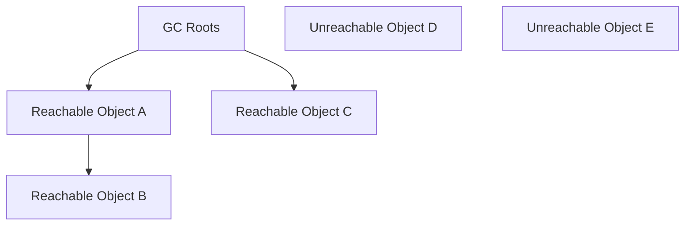

# Java Fundamentals – Advanced Interview Questions

## 1. Objective

This document covers deeper JVM and Java runtime questions.

It focuses on:

- Class loading internals.
- Class identity and isolation.
- JVM memory behavior.
- Garbage Collection.
- JIT optimization.
- Runtime performance.
- Bytecode verification.
- Native interoperability.
- JVM troubleshooting.

These questions are useful for backend engineering interviews and discussions about Java application internals.

---

## 2. Advanced Class Loading

### Q1. Why does Java need a Class Loader hierarchy?

The Class Loader hierarchy separates responsibility for loading different categories of classes.

It also supports parent delegation, which helps maintain consistency and prevents ordinary application classes from replacing fundamental runtime classes.

### Q2. Can two Class Loaders load classes with the same fully qualified name?

Yes.

For example:

```text
Loader A -> com.example.User
Loader B -> com.example.User
```

If both class loaders independently define the class, these are different runtime types.

### Q3. What determines class identity in Java?

Class identity is determined by:

1. The binary name of the class.
2. The defining class loader.

Therefore, two classes with the same name can still be incompatible if they were defined by different class loaders.

### Q4. What is a custom Class Loader used for?

Custom class loaders are useful for:

- Plugin systems.
- Application servers.
- Module isolation.
- Dynamic class loading.
- Framework infrastructure.

### Q5. Can a class be loaded but not initialized?

Yes.

Loading and initialization are separate lifecycle stages.

A class may be loaded and linked before its initialization is triggered.

### Q6. What happens if static initialization fails?

If class initialization fails because a static initializer throws an exception, the JVM can mark the class erroneous.

The first active use may produce an `ExceptionInInitializerError` when the underlying exception is not an `Error`.

Subsequent initialization attempts can result in `NoClassDefFoundError`.

---

## 3. Advanced JVM Memory Questions

### Q7. Is the Java Stack stored in the Heap?

They are logically distinct JVM runtime areas.

Each thread has its own Java Stack, while the Heap is shared across threads.

Their physical implementation is JVM-specific.

### Q8. Can objects exist without a physical heap allocation?

A JVM implementation may optimize object allocation.

For example, escape analysis can help the JIT compiler eliminate an allocation or replace object state with scalar values when the object does not need to exist as a separate heap object.

This is an optimization, not a general guarantee that Java objects are stack allocated.

### Q9. What is escape analysis?

Escape analysis determines whether an object reference can escape a particular scope or thread.

The JIT compiler can use this information to apply optimizations such as:

- Allocation elimination.
- Scalar replacement.
- Lock elimination in eligible cases.

### Q10. What is scalar replacement?

Scalar replacement is an optimization where the fields of an object are treated as separate values rather than requiring the object to be allocated as a single object.

It may be possible when the object does not escape and the compiler can safely optimize it.

### Q11. What is Metaspace?

Metaspace is the HotSpot JVM memory area used for class metadata.

Unlike the ordinary Java heap, Metaspace uses native memory.

### Q12. Can Metaspace cause OutOfMemoryError?

Yes.

If the JVM cannot allocate the required class metadata memory, it may throw:

```text
java.lang.OutOfMemoryError: Metaspace
```

### Q13. What is the difference between Heap OutOfMemoryError and Metaspace OutOfMemoryError?

| Heap OutOfMemoryError | Metaspace OutOfMemoryError |
|---|---|
| Heap allocation cannot be satisfied | Class metadata allocation cannot be satisfied |
| May be associated with excessive object retention | May be associated with excessive class loading or metadata growth |
| Concerns heap memory | Concerns HotSpot Metaspace |

---

## 4. Advanced Garbage Collection

### Q14. How does Garbage Collection determine whether an object is reachable?

The garbage collector starts from GC Roots and traces references to determine which objects remain reachable.

Objects that cannot be reached through these references are eligible for reclamation.



### Q15. Why is reference counting alone insufficient for Java Garbage Collection?

Reference counting cannot independently identify all unreachable cycles.

Example:

```text
Object A -> Object B
Object B -> Object A
```

Neither object has an external reference, but each has a reference count greater than zero.

Tracing garbage collectors can identify that the cycle is unreachable from GC Roots.

### Q16. What is a strong reference?

A normal Java reference is a strong reference.

As long as an object is reachable through a strong reference from GC Roots, it is considered reachable.

### Q17. What are weak, soft, and phantom references?

These are special reference types from `java.lang.ref`.

| Reference Type | General Purpose |
|---|---|
| Strong | Normal object reachability |
| Soft | References that may be cleared under memory pressure |
| Weak | References that do not keep an object strongly reachable |
| Phantom | Used for advanced post-mortem cleanup coordination |

Do not rely on these reference types as a replacement for correct resource management.

### Q18. Does calling `System.gc()` guarantee garbage collection?

No.

```java
System.gc();
```

It requests that the JVM consider performing garbage collection.

The JVM is not required to perform a collection immediately, and the request may be ignored.

### Q19. What is a stop-the-world pause?

A stop-the-world pause is a period during which application threads are paused while the JVM performs certain operations.

Many garbage collectors have stop-the-world phases, although modern collectors can perform significant work concurrently.

### Q20. What is the difference between throughput and latency in Garbage Collection?

- **Throughput:** The proportion of total time spent doing useful application work.
- **Latency:** The delay or pause experienced by the application during collection.

A collector may optimize for one or balance both.

### Q21. Name some HotSpot Garbage Collectors.

Examples include:

- Serial GC.
- Parallel GC.
- G1 GC.
- ZGC.
- Shenandoah GC.

Availability and support depend on the JDK distribution and version.

### Q22. What is G1 GC?

G1 stands for Garbage-First Garbage Collector.

It divides the heap into regions and aims to meet configurable pause-time goals while collecting regions with high expected reclamation value.

### Q23. What is ZGC?

ZGC is a low-latency garbage collector designed to keep pause times very low, including for large heaps.

Its exact capabilities and implementation have evolved across JDK releases.

---

## 5. Advanced JIT and Execution Questions

### Q24. What is tiered compilation?

Tiered compilation is a strategy in HotSpot where code may progress through multiple execution and compilation levels.

It balances quick startup with more aggressive optimization.

### Q25. What is speculative optimization?

Speculative optimization uses assumptions based on observed runtime behavior.

For example, the JIT may optimize a call site based on the types observed during profiling.

If the assumptions become invalid, the JVM can deoptimize the compiled code.

### Q26. What is deoptimization?

Deoptimization is the process of leaving optimized machine code when its assumptions are no longer valid or an execution condition requires a less optimized path.

The JVM can reconstruct the necessary execution state and continue safely.

### Q27. What is method inlining?

Method inlining replaces an eligible method call with the method's body during compilation.

It reduces call overhead and can expose more optimization opportunities.

### Q28. What is dead code elimination?

Dead code elimination removes computations whose results are not needed and whose removal does not change observable program behavior.

Example:

```java
int a = 10;
int b = 20;
int result = a + b;
```

If `result` is never used and the computation has no observable side effects, the JIT may eliminate the unnecessary calculation.

### Q29. Why can a Java application become faster after warm-up?

The JVM collects runtime information and may compile frequently executed code into optimized native machine code.

The effect depends on workload, JVM configuration, and compilation decisions.

### Q30. What is the difference between JIT and AOT?

| JIT | AOT |
|---|---|
| Compiles during execution | Compiles before execution |
| Can use runtime profiling | Uses information available during build time |
| May have warm-up overhead | Can reduce runtime compilation overhead |
| Dynamic runtime optimizations | Build-time optimization opportunities |

---

## 6. Advanced Bytecode and Verification

### Q31. What is bytecode verification?

Bytecode verification checks that a class file's bytecode is valid according to JVM rules.

It helps ensure that bytecode follows constraints involving:

- Instruction validity.
- Type safety.
- Operand stack usage.
- Control flow.
- Method invocation rules.

### Q32. Why does Java need bytecode verification?

It helps protect the runtime from malformed or invalid bytecode and contributes to JVM safety.

It is one layer of JVM security, not a complete security solution by itself.

### Q33. What is the runtime constant pool?

Each class or interface has a runtime constant pool derived from its class-file constant pool.

It contains constants and symbolic references used during execution and linkage.

### Q34. What is a method descriptor?

A method descriptor represents a method's parameter types and return type in JVM class-file format.

For example:

```java
int add(int a, int b)
```

Has the descriptor:

```text
(II)I
```

Here:

- First `I`: first integer parameter.
- Second `I`: second integer parameter.
- Final `I`: integer return type.

### Q35. What is the difference between bytecode and native code?

Bytecode is designed for JVM execution.

Native code is machine instructions designed for a specific processor architecture.

The JIT compiler can transform selected bytecode into native code.

---

## 7. Native Interoperability

### Q36. What is JNI?

JNI is the Java Native Interface, which allows Java code to interact with native implementations.

### Q37. Why can JNI introduce platform dependency?

Native libraries are compiled for specific operating systems and architectures.

Therefore, an application using JNI may need separate native library builds for different platforms.

### Q38. What are the risks of JNI?

- Invalid native memory access.
- Memory leaks.
- Native crashes.
- Platform-specific dependencies.
- Debugging complexity.

### Q39. What is the Foreign Function and Memory API?

The FFM API provides Java mechanisms for interacting with foreign functions and native memory.

It was finalized in JDK 22.

It provides an alternative to traditional JNI for many native interoperability use cases.

---

## 8. JVM Troubleshooting Scenarios

### Scenario 1: Application Memory Keeps Increasing

An application runs for hours, and heap usage continues increasing.

Possible causes:

- Objects are unnecessarily retained.
- Static collections keep growing.
- Cache eviction is missing.
- Listeners or callbacks retain references.
- Resources are not managed properly.

Useful investigation tools include:

- Java Flight Recorder.
- Java Mission Control.
- `jcmd`.
- Heap dumps.
- Garbage Collection logs.

### Scenario 2: StackOverflowError

An application throws:

```text
java.lang.StackOverflowError
```

Possible causes:

- Infinite recursion.
- Very deep recursion.
- Circular method invocation.

Investigate the stack trace and method-call pattern.

### Scenario 3: OutOfMemoryError: Java Heap Space

Possible causes:

- Too many live objects.
- Excessive allocation.
- Large data loaded into memory.
- Memory leak.
- Insufficient heap limit.

### Scenario 4: OutOfMemoryError: Metaspace

Possible causes:

- Excessive class loading.
- Class-loader leaks.
- Excessive generated classes.
- Metaspace memory limit reached.

### Scenario 5: Application Is Slow After Deployment

Possible causes:

- JVM warm-up.
- Excessive garbage collection.
- Slow database calls.
- Thread contention.
- Poor JIT optimization opportunities.
- Insufficient CPU or memory resources.

Do not assume every performance problem is caused by the JVM.

---

## 9. Advanced Interview Questions: Rapid Revision

1. What determines class identity?
2. Can two class loaders define the same class name?
3. What happens if class initialization fails?
4. What is escape analysis?
5. What is scalar replacement?
6. What is Metaspace?
7. What are GC Roots?
8. Why is reference counting insufficient by itself?
9. What are weak references?
10. Does `System.gc()` guarantee collection?
11. What is a stop-the-world pause?
12. What is G1 GC?
13. What is ZGC?
14. What is tiered compilation?
15. What is speculative optimization?
16. What is deoptimization?
17. What is dead code elimination?
18. What is a method descriptor?
19. What is bytecode verification?
20. What is FFM?

---

## 10. Final Self-Assessment

I should be able to:

- [ ] Explain class identity and class-loader isolation.
- [ ] Explain class initialization failure.
- [ ] Explain escape analysis.
- [ ] Explain scalar replacement.
- [ ] Differentiate Heap and Metaspace errors.
- [ ] Explain GC Roots and reachability.
- [ ] Explain different reference types.
- [ ] Explain stop-the-world pauses.
- [ ] Compare major garbage collectors.
- [ ] Explain tiered compilation.
- [ ] Explain speculative optimization and deoptimization.
- [ ] Explain bytecode verification.
- [ ] Explain method descriptors.
- [ ] Explain JNI and FFM.
- [ ] Investigate common JVM errors.

## Related Topics

- [Class Loader](../../05-JVM-Architecture/class-loader.md)
- [Runtime Data Areas](../../05-JVM-Architecture/runtime-data-areas.md)
- [Execution Engine](../../05-JVM-Architecture/execution-engine.md)
- [JNI and Native Libraries](../../05-JVM-Architecture/jni-and-native-libraries.md)
- [JVM Architecture](../../05-JVM-Architecture/jvm-architecture.md)