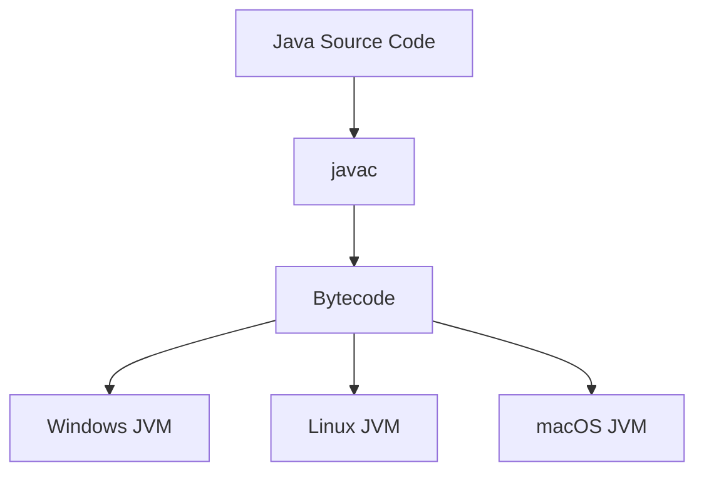
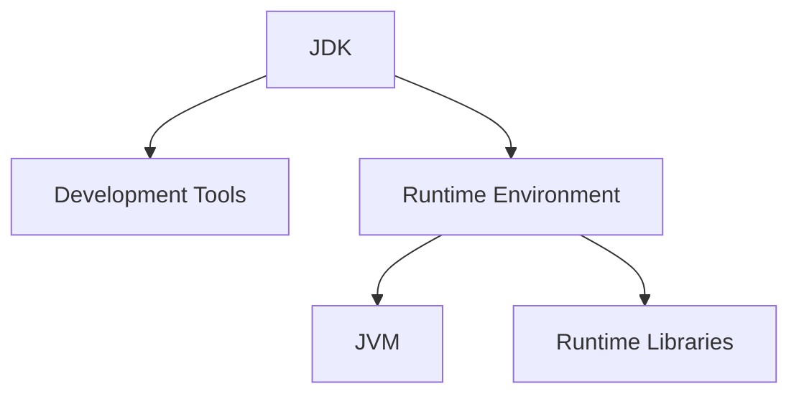
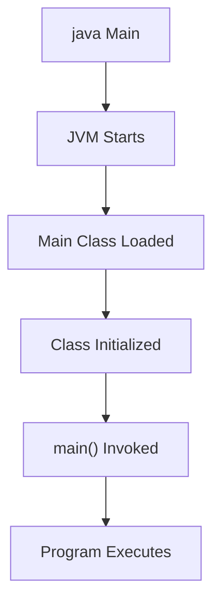

# Java Fundamentals – Basic Interview Questions

## 1. Objective

This document covers basic Java interview questions related to:

- Java fundamentals.
- Java features.
- Platform independence.
- JDK, JRE, and JVM.
- Compilation and execution.
- Basic JVM architecture.

The goal is to build a strong foundation before moving to intermediate and advanced questions.

---

## 2. Java Fundamentals

### Q1. What is Java?

Java is a high-level, class-based, object-oriented programming language designed to be portable across platforms.

Java source code is compiled into bytecode, which can be executed by a compatible JVM.

### Q2. Who developed Java?

Java was originally developed by James Gosling and his team at Sun Microsystems.

It was released publicly in 1995.

### Q3. Why is Java platform-independent?

Java source code is compiled into platform-independent bytecode.

A compatible JVM for the target platform executes that bytecode.

### Q4. What is WORA?

WORA means **Write Once, Run Anywhere**.

It describes Java's ability to run the same bytecode on different platforms, provided a compatible JVM and required dependencies are available.

### Q5. Is Java purely object-oriented?

No.

Java supports object-oriented programming, but it also has primitive data types such as:

- `int`
- `char`
- `boolean`
- `double`

These are not objects.

### Q6. What are the main features of Java?

- Platform independent.
- Object-oriented.
- Robust.
- Secure.
- Multithreaded.
- Portable.
- Architecture neutral.
- Dynamic.
- Automatic memory management.

### Q7. What is bytecode?

Bytecode is the intermediate instruction format generated by the Java compiler and stored in `.class` files.

The JVM loads and executes it.

### Q8. What is the difference between Java and C++?

| Java | C++ |
|---|---|
| Uses JVM bytecode execution | Usually compiles to native machine code |
| Automatic garbage collection | Manual and automatic resource-management techniques |
| No general pointer arithmetic in ordinary Java | Supports pointer arithmetic |
| No multiple inheritance of classes | Supports multiple inheritance |
| Supports platform independence through JVM | Native binaries are generally platform-specific |

---

## 3. JDK, JRE, and JVM

### Q9. What is JVM?

JVM stands for Java Virtual Machine.

It is an abstract machine that provides the runtime environment for executing Java bytecode.

### Q10. What is JRE?

JRE stands for Java Runtime Environment.

It is the conceptual runtime package consisting of the JVM and the libraries and supporting components needed to run Java applications.

### Q11. What is JDK?

JDK stands for Java Development Kit.

It provides the tools required to develop, compile, debug, package, and run Java applications.

### Q12. What is the difference between JDK, JRE, and JVM?

| JDK | JRE | JVM |
|---|---|---|
| Development toolkit | Runtime environment concept | Bytecode execution engine |
| Includes compiler and tools | Provides runtime components | Executes bytecode |
| Used by developers | Used to run applications | Used during execution |

This is the traditional conceptual relationship. Modern Java distributions may package runtime components differently.

### Q13. Can we run Java without JDK?

Yes, if an appropriate Java runtime is available.

The JDK is needed to compile source code using `javac`. Running an already compiled application requires a compatible runtime.

### Q14. Is JVM platform-independent?

No.

The JVM implementation is platform-dependent because it needs to work with the underlying operating system and hardware.

Java bytecode is portable; the JVM implementation is specific to its target platform.

---

## 4. Java Compilation and Execution

### Q15. What is a compiler?

A compiler translates source code into another representation.

In Java, `javac` compiles `.java` source files into `.class` bytecode files.

### Q16. What is an interpreter?

An interpreter executes instructions at runtime.

The JVM can interpret Java bytecode instructions.

### Q17. Does Java use a compiler or interpreter?

Java uses both compilation and runtime execution mechanisms.

1. `javac` compiles source code into bytecode.
2. The JVM can interpret bytecode.
3. A JIT compiler can compile selected frequently executed code into native machine code.

### Q18. What happens when we execute `java Main`?

The Java launcher starts the JVM and launches the specified class.

Conceptually:

### Q19. What is JIT?

JIT stands for Just-In-Time Compiler.

It compiles selected bytecode into native machine code at runtime, often using profiling information.

### Q20. What is the difference between `.java` and `.class`?

| `.java` | `.class` |
|---|---|
| Java source file | Compiled class file |
| Human-readable source code | Contains JVM bytecode and class-file structures |
| Written by developers | Generated by compiler or other bytecode tools |
| Input to `javac` | Input to JVM class loading |

---

## 5. Basic JVM Architecture

### Q21. What are the major components of JVM Architecture?

- Class Loader Subsystem.
- Runtime Data Areas.
- Execution Engine.
- JNI and Native Libraries.

### Q22. What is a Class Loader?

A JVM component responsible for loading class definitions into memory.

### Q23. What are the phases of class loading?

1. Loading.
2. Linking.
3. Initialization.

Linking consists of verification, preparation, and resolution.

### Q24. What is Heap memory?

Heap is the shared runtime memory area where Java objects and arrays are allocated.

### Q25. What is Stack memory?

Each Java thread has its own Java Stack.

It stores stack frames associated with method calls.

### Q26. What is Garbage Collection?

Garbage Collection is the JVM's automatic memory-management mechanism for reclaiming memory occupied by objects that are no longer reachable.

### Q27. What is JNI?

JNI stands for Java Native Interface.

It allows Java code to interact with native implementations, commonly written in C or C++.

---

## 6. Important Conceptual Comparisons

### Q28. Heap vs Stack

| Heap | Stack |
|---|---|
| Shared among threads | Per-thread |
| Objects and arrays | Method frames |
| GC-managed | Frames pushed and popped during calls |
| Object lifetime depends on reachability | Frame lifetime follows method execution |

### Q29. Compiler vs Interpreter

| Compiler | Interpreter |
|---|---|
| Translates code | Executes instructions |
| `javac` compiles Java source | JVM interpreter executes bytecode |
| Generates bytecode | Executes bytecode |

### Q30. Bytecode vs Machine Code

| Bytecode | Machine Code |
|---|---|
| JVM instruction format | CPU instruction format |
| Portable in the Java execution model | Processor-specific |
| Executed by JVM | Executed by CPU |

---

## 7. Rapid-Fire Revision

Try answering each question without reading its answer.

1. What is Java?
2. Who developed Java?
3. What does WORA mean?
4. What is bytecode?
5. Why is JVM platform-dependent?
6. What does JDK provide?
7. What is the purpose of JRE?
8. What does JVM do?
9. What is JIT?
10. What is Garbage Collection?
11. What is a Class Loader?
12. What is Heap?
13. What is a Stack Frame?
14. What is JNI?
15. What is `javac`?

---

## 8. Self-Assessment

- [ ] I can explain Java in my own words.
- [ ] I can explain platform independence.
- [ ] I can differentiate JDK, JRE, and JVM.
- [ ] I can explain the Java compilation process.
- [ ] I can explain the role of JIT.
- [ ] I can draw basic JVM Architecture.
- [ ] I can explain Heap and Stack.
- [ ] I can explain Garbage Collection.

## Related Topics

- [What is Java?](../../01-Java-Basics/what-is-java.md)
- [JDK](../../03-Java-Platform/jdk.md)
- [JRE](../../03-Java-Platform/jre.md)
- [JVM](../../03-Java-Platform/jvm.md)
- [JVM Architecture](../../05-JVM-Architecture/jvm-architecture.md)
- [Intermediate Questions](intermediate-questions.md)