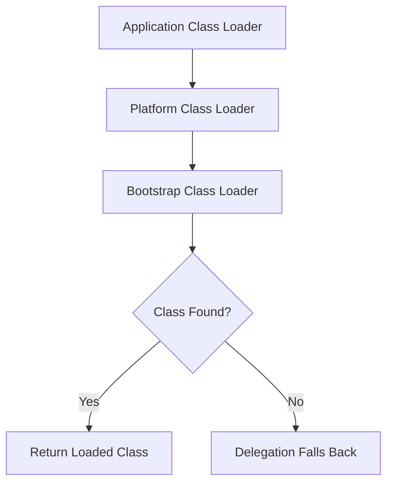

# Java Fundamentals – Intermediate Interview Questions

## 1. Objective

This document covers intermediate questions that test whether you understand how Java works internally.

Topics include:

- Class loading.
- Class Loader hierarchy.
- Linking and initialization.
- JVM runtime memory.
- Stack frames.
- Garbage Collection.
- JIT compilation.
- Classpath and bytecode.
- Java runtime behavior.

---

## 2. Class Loading

### Q1. What is the Parent Delegation Model?

The Parent Delegation Model is a class-loading approach in which a class loader delegates a loading request to its parent before attempting to load the class itself.



This helps avoid unnecessary duplicate loading and protects core runtime classes from ordinary application-level replacement.

### Q2. What are the three built-in Class Loaders?

- Bootstrap Class Loader.
- Platform Class Loader.
- Application Class Loader.

### Q3. What is the difference between loading, linking, and initialization?

| Phase | Purpose |
|---|---|
| Loading | Finds and loads class bytecode |
| Linking | Verifies, prepares, and resolves |
| Initialization | Executes static initialization code |

### Q4. What happens during verification?

The JVM verifies that class-file bytecode is structurally valid and follows JVM rules.

### Q5. What happens during preparation?

Memory is allocated for static fields, and those fields receive default values.

For example:

```java
class Test {
    static int count = 10;
}
```

During preparation, `count` receives `0`. Its explicit assignment to `10` occurs during initialization.

### Q6. What happens during initialization?

The JVM executes class initialization code, including explicit static field initializers and static initialization blocks.

### Q7. Can a class be loaded without being initialized?

Yes.

Loading and initialization are separate stages. A class may be loaded before it is initialized.

---

## 3. Runtime Data Areas

### Q8. Which JVM memory areas are shared among threads?

The Heap and Method Area.

### Q9. Which JVM memory areas are per-thread?

- Java Stack.
- PC Register.
- Native Method Stack.

### Q10. What is a Stack Frame?

A Stack Frame is created for a method invocation.

It conceptually contains:

- Local variables.
- Operand stack.
- Runtime constant pool reference.
- Information needed for method completion.

### Q11. What happens when a method is called?

A new frame is created for that method on the calling thread's Java Stack.

When the method returns, the frame is removed.

### Q12. Why does each thread have its own Java Stack?

Each thread has its own method invocation sequence and local execution state.

Separate stacks prevent the local stack frames of different threads from being mixed together.

### Q13. What is the difference between Method Area and Metaspace?

Method Area is a logical memory area defined by the JVM specification.

Metaspace is the HotSpot JVM implementation's memory area for class metadata.

### Q14. What is the PC Register?

The Program Counter Register tracks the current JVM instruction for a thread executing a non-native method.

### Q15. What causes StackOverflowError?

Excessive stack-frame creation can exhaust a thread's stack.

Example:

```java
static void recurse() {
    recurse();
}
```

This creates unbounded recursive calls and can result in `StackOverflowError`.

### Q16. What causes OutOfMemoryError?

An `OutOfMemoryError` occurs when the JVM cannot allocate required memory in a relevant memory area.

Possible reasons include:

- Excessive object allocation.
- Retained objects.
- Memory leaks.
- Insufficient memory limits.
- Excessive class metadata loading.

---

## 4. Heap and Garbage Collection

### Q17. How does an object become eligible for Garbage Collection?

An object becomes eligible when it is no longer reachable from GC roots.

Example:

```java
Student student = new Student();

student = null;
```

If no other reachable reference points to the object, it may become eligible.

### Q18. Does setting a reference to null immediately destroy an object?

No.

It only removes that particular reference. The object may remain reachable through other references, and GC is not guaranteed to run immediately.

### Q19. What are GC Roots?

GC Roots are starting points used by the garbage collector to determine object reachability.

Examples include:

- References in active thread stacks.
- References from static fields in relevant loaded classes.
- JNI references.
- Other JVM-defined runtime roots.

### Q20. What is a memory leak in Java?

A memory leak occurs when an application unnecessarily retains references to objects that it no longer needs.

The garbage collector cannot reclaim objects that remain reachable.

Example:

```java
import java.util.ArrayList;
import java.util.List;

class Cache {

    static List<byte[]> data = new ArrayList<>();

    static void addData() {
        data.add(new byte[1024 * 1024]);
    }
}
```

If data is continually added and never removed, memory usage can grow unnecessarily.

### Q21. What is the difference between StackOverflowError and OutOfMemoryError?

| StackOverflowError | OutOfMemoryError |
|---|---|
| Stack cannot accommodate further execution frames | JVM cannot allocate required memory |
| Often associated with deep recursion | Can be associated with excessive allocation or retained memory |
| Usually affects a particular thread's stack | Depends on the exhausted memory area |

---

## 5. Execution Engine and JIT

### Q22. Why does JVM use both Interpreter and JIT?

The Interpreter supports initial execution without compiling every method into native code.

The JIT compiler optimizes selected frequently executed code paths.

Together, they balance startup behavior and runtime performance.

### Q23. What is hot code?

Frequently executed code that becomes a candidate for JIT compilation.

### Q24. What is runtime profiling?

Runtime profiling collects information about how code behaves during execution.

The JVM can use that information when deciding which code to optimize.

### Q25. What is method inlining?

Method inlining is an optimization in which the JIT compiler replaces an eligible method call with the method's body.

It can reduce method-call overhead and enable additional optimizations.

### Q26. What is JVM warm-up?

The JVM may initially execute code using interpretation or less optimized compilation.

As runtime profiling and compilation occur, frequently executed code can become more optimized.

This period is commonly called JVM warm-up.

### Q27. Does JIT compile every method?

No.

JIT compilation decisions depend on runtime behavior, thresholds, JVM implementation, and configuration.

### Q28. What is deoptimization?

Deoptimization occurs when the JVM invalidates or abandons optimized machine code because assumptions used during optimization are no longer valid.

The JVM can return execution to a less optimized execution path and continue safely.

---

## 6. Bytecode and Class Files

### Q29. What is the Constant Pool?

The class-file constant pool stores constants and symbolic references used by a class.

Examples include:

- String literals.
- Class names.
- Field references.
- Method references.
- Numeric constants.

### Q30. What is the difference between `javac` and `javap`?

| `javac` | `javap` |
|---|---|
| Java compiler | Class-file inspection tool |
| Generates bytecode | Displays class information and bytecode |
| Input: `.java` | Input: `.class` or class name |

### Q31. What is classpath?

Classpath specifies locations where Java tools should look for user classes and libraries.

Example:

```powershell
java -cp out com.example.Main
```

### Q32. What is a class-file version?

Every class file has a version indicating its class-file format.

A JVM checks compatibility before loading and executing the class.

---

## 7. Java Runtime and Class Identity

### Q33. Can two Class Loaders load a class with the same fully qualified name?

Yes.

If different class loaders independently define classes with the same fully qualified name, the JVM treats them as different runtime types.

Class identity depends on both the binary class name and the defining class loader.

### Q34. What is ClassNotFoundException?

It is a checked exception that may occur when an application explicitly requests a class by name but the class cannot be found.

Example:

```java
Class.forName("com.example.MissingClass");
```

### Q35. What is NoClassDefFoundError?

It is a linkage error that can occur when a class definition that was available during compilation or an earlier phase cannot be found when required at runtime.

### Q36. What is the difference between ClassNotFoundException and NoClassDefFoundError?

| ClassNotFoundException | NoClassDefFoundError |
|---|---|
| Checked exception | Error |
| Often occurs during explicit dynamic class loading | Often occurs during normal linkage or use |
| Indicates requested class could not be located | Indicates a required class definition is unavailable at runtime |

---

## 8. Practical Interview Scenarios

### Scenario 1: Static Field Initialization

```java
class Example {

    static int count = 10;

    static {
        count = 20;
    }
}
```

Question: What is the final value of `count` after class initialization?

Answer: `20`, because the static field assignment happens before the static block in source order.

### Scenario 2: Object Reachability

```java
Student s1 = new Student();
Student s2 = s1;

s1 = null;
```

Question: Is the object eligible for GC?

Answer: No, because `s2` still references it.

### Scenario 3: Recursion

```java
static void test() {
    test();
}
```

Question: Which error can occur?

Answer: `StackOverflowError`.

### Scenario 4: Missing Class at Runtime

An application compiles successfully but fails because a required dependency is absent at runtime.

Question: What could happen?

Answer: The JVM may throw a `NoClassDefFoundError` or another class-loading-related error, depending on the exact situation.

### Scenario 5: JIT

A Java application becomes faster after executing for some time.

Question: What JVM behavior could explain this?

Answer: Runtime profiling and JIT compilation may have optimized frequently executed code.

---

## 9. Rapid-Fire Revision

1. What is Parent Delegation?
2. What are the three class-loading phases?
3. What is verification?
4. What is preparation?
5. What is resolution?
6. What is a Stack Frame?
7. What is Metaspace?
8. What are GC Roots?
9. What is object reachability?
10. What is a memory leak?
11. What is method inlining?
12. What is deoptimization?
13. What is a Constant Pool?
14. What is classpath?
15. What determines class identity?

---

## 10. Self-Assessment

- [ ] I can explain Parent Delegation.
- [ ] I can explain all class-loading phases.
- [ ] I can draw Runtime Data Areas.
- [ ] I can explain Stack Frames.
- [ ] I can distinguish Heap and Stack.
- [ ] I understand object reachability.
- [ ] I can distinguish common JVM errors.
- [ ] I understand JIT and runtime profiling.
- [ ] I understand class identity and class loaders.
- [ ] I can explain bytecode and class-file metadata.

## Related Topics

- [Class Loader](../../05-JVM-Architecture/class-loader.md)
- [Runtime Data Areas](../../05-JVM-Architecture/runtime-data-areas.md)
- [Execution Engine](../../05-JVM-Architecture/execution-engine.md)
- [JVM Architecture](../../05-JVM-Architecture/jvm-architecture.md)
- [Advanced Questions](advanced-questions.md)