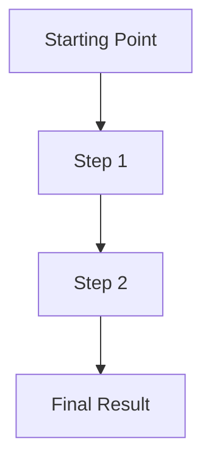

# [Concept Name]

> **Category:** Java Fundamentals  
> **Difficulty:** Beginner / Intermediate / Advanced  
> **Status:** Revised / Needs Revision

## 1. What is it?

Explain the concept in simple words.

## 2. Why do we need it?

- What problem does it solve?
- What was the limitation before this concept?
- Why was this approach introduced?

## 3. How does it work internally?

Explain the internal working step by step.

## 4. Visual Understanding

Add a flowchart, architecture diagram, sequence diagram or memory diagram.



## 5. Code Examples

### Basic Example

```java
// Add a simple Java example
```

### Practical Example

```java
// Add a real-world or slightly advanced example
```

## 6. Important Points

- Point 1
- Point 2
- Point 3

## 7. Comparisons and Related Concepts

| Concept A | Concept B | Difference |
| --------- | --------- | ---------- |
|           |           |            |

## 8. Real-World Applications

Where is this concept used in actual Java development?

## 9. Interview Questions

### Basic
1. 

### Intermediate
1. 

### Advanced / Tricky
1. 

## 10. Practice Questions

### Conceptual
1. 

### Scenario-Based
1. 

### Coding
1. 

## 11. Common Mistakes and Misconceptions

| Incorrect understanding | Correct understanding |
| ----------------------- | --------------------- |
|                         |                       |

## 12. Quick Revision

Summarize the entire concept in 5–10 bullet points.

## 13. My Understanding

Explain this concept in your own words, as if teaching another developer.

## 14. Revision Tracking

- [ ] First understanding
- [ ] Documentation completed
- [ ] Diagram created
- [ ] Code practiced
- [ ] Interview questions attempted
- [ ] Explained without notes
- [ ] Final revision completed

**Last revised:** YYYY-MM-DD